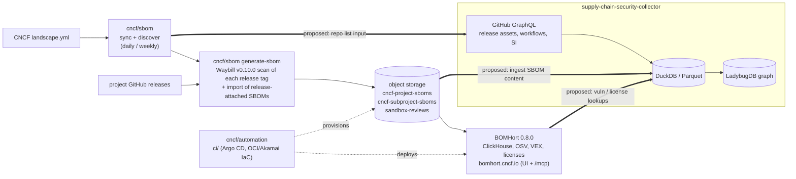

# Supply chain tooling in cncf/automation, and what we can reuse

**CNCF already rebuilds SBOMs for every CNCF project from source, daily, with dependency graphs, and serves them through BOMHort. That corpus is the biggest thing the collector could reuse: it fills the gap we could not close from GitHub release assets.**

Surveyed 2026-11-26 at [`cncf/automation@740bb76`](https://github.com/cncf/automation/tree/740bb76ebc5a3ddb08e7483bcd0101e6bb2af1ed) and [`cncf/sbom@e74ea3b`](https://github.com/cncf/sbom/tree/e74ea3b262c828a0c26664a3f037dc91b5035010). The SBOM pipeline started in cncf/automation (commit `5a8163be`, 2026-02-10) and moved to cncf/sbom. The old workflows were removed from automation on 2026-04-15 (`fb27dbf5`, "remove stale supply-chain workflows"), so both repos are covered here.

## How the pieces fit

## Inventory

| Tool | Where | What it does | Serves | Maturity |
|---|---|---|---|---|
| **Waybill** (Kusari, formerly Mikebom) | cncf/sbom `util/sbom-lib.sh` (`sbom_waybill_scan`) | Scans each stable release tag's source into SPDX 2.3 JSON, with lockfile-derived `DEPENDS_ON` edges, build/test scopes (`*_DEPENDENCY_OF`), deps.dev and ClearlyDefined license enrichment | ~239 CNCF project repos (`cncf-projects.yaml`), ~2,150 subproject repos (`discovered-repos.yaml`), 34 manual entries, sandbox applications | v0.10.0 pinned; daily runs. README: "NOT official SBOMs" |
| Release-asset importer | cncf/sbom `sbom_import_release_assets` | Picks JSON assets matching `(spdx\|cdx\|cyclonedx\|bom).*\.json$`, sniffs format from content (SPDX 2, SPDX 3, CycloneDX), classifies project-wide vs per-binary by OS/arch token. A project-wide SPDX asset replaces the Waybill scan | same | Active |
| SBOM post-processors | cncf/sbom `postprocess-{spdx,cdx,spdx3}.sh` | Normalise root package to purl `pkg:github/<owner>/<repo>@<tag>`, name, version, supplier, so consumers can key on them | same | Active |
| **BOMHort** (seebom-labs, OpenSSF Sandbox) | cncf/automation `ci/cluster/services/apps/bomhort.yaml` | Ingests the three buckets into ClickHouse; OSV vuln lookups, VEX, license compliance against `exceptions.cncf.io`; read-only REST API and MCP server | Hosted at `bomhort.cncf.io` / `seebom.cncf.io` (UI at `/`, MCP at `/mcp`, token-gated) | Chart 0.8.0 (2026-10-23). [OpenSSF Sandbox since 2026-08](https://openssf.org/blog/2026/08/28/introducing-bomhort-kubernetes-native-sbom-visualization-governance-at-scale-joins-the-openssf-sandbox/) |
| SBOM buckets | cncf/automation `ci/iac/oracle/buckets/tfvars/cncf-sboms.tfvars` | `cncf-project-sboms`, `cncf-subproject-sboms`, `access_type = ObjectRead` (public read in OCI), replicated San Jose → Ashburn. BOMHort reads them from a Linode endpoint | BOMHort, anyone with read access | Active. Public listing not verified (blocked from this environment) |
| Waybill tooling SBOM | cncf/automation `generate-tooling-sbom.yml` + `.github/scripts/generate-tooling-sbom.sh` | SBOMs for automation's own code: one per Go module/Python utility, one for the repo tree, one SPDX inventory of the CI chain (actions + tools). Committed to `tooling-sbom/` on every push to main | cncf/automation itself | Active, but pinned to Waybill **v0.2.0** vs v0.10.0 in cncf/sbom |
| `sigs.k8s.io/bom` + `go-licenses` | cncf/automation `reusable-generate-sbom.yml` | Earlier generator: `bom generate` per release, licenses grafted in with `jq` | Nothing: no caller in the repo since 2026-04-15 | Orphaned |
| cosign (keyless) | `publish-runner-images.yml`, `publish-cloudrunner-images.yml`, `publish-landscape-mcp-server.yml` | Signs images by digest via Fulcio | `ghcr.io/cncf/external-gha-runner`, `gha-cloudrunner`, `landscape-mcp-server` | Active |
| SLSA L3 provenance | same runner-image workflows, `slsa-github-generator` `generator_container_slsa3.yml@v2.1.0` | Generates provenance, then `cosign verify-attestation --type slsaprovenance` | Runner images only (not the MCP server) | Active; slsa-verifier step still a TODO |
| Kusari Inspector | `kusari.yaml` | PR checks for unpinned actions and container tags; its SBOM option is off | cncf/automation PRs | Active |
| witness + sbomit | was in `ci/gha-runner-vm/main.go` | Installed into self-hosted runner VM images (2026-09-02) | CNCF self-hosted runners | **Removed** 2026-10-27 (`8ed4d060`) |
| Dependabot, SHA-pinned actions | `.github/dependabot.yml`, all workflows | Grouped updates; actions pinned to commit SHA | cncf/automation | Active |
| Project metadata tools | `utilities/dot-project`, `landscape-mcp-server`, `audit_project_lifecycle_across_tools` | `.project` schema + validator (incl. `security.policy`, `security.contact`, `audits`); landscape MCP server (12 read-only tools); cross-checks of landscape, CLOMonitor, LFX Insights health, PCC | CNCF staff, projects, agents | Active |

Not present in either repo: syft, trivy, grype, scorecard, OSV-Scanner, GUAC, `actions/attest-*`. Grype/syft/trivy appear only as names inside the generated tooling SBOMs and imported project SBOMs (e.g. flux ships a syft SBOM).

## What we can reuse

Ranked by value to the initiative's two target questions (CVE impact, license "rug pull", [cncf/toc#1873](https://github.com/cncf/toc/issues/1873)).

1. **Ingest the cncf/sbom corpus as a new channel (collector).** It has what our data lacks: package lists, dependency edges and licenses per release, for ~2,400 repos. Add `base_sbom_documents`, `base_sbom_packages`, `base_sbom_relationships`, keyed on the guaranteed root purl and the bucket key, streamed with DuckDB `read_json` so it never has to fit in memory. Load packages and `DEPENDS_ON` edges into LadybugDB; the blast-radius and rug-pull questions become Cypher traversals. Needs: confirm the buckets are publicly listable, or ask CNCF staff for a read key.
2. **Use BOMHort for vuln and license answers instead of rebuilding them (collector, Panorama).** BOMHort already joins the same SBOMs to OSV, VEX and the CNCF license exceptions. Pull its read-only REST endpoints into `raw_bomhort_*` tables, or point a Panorama data plugin at its MCP server. Needs an MCP token from CNCF; REST reachability of `bomhort.cncf.io` not verified.
3. **Take cncf/sbom's repo list as an input (collector).** `cncf-projects.yaml` + `discovered-repos.yaml` (with `parent_project`) is the same shape as our rich input and covers subprojects we skip. Joining on its project slug also lines our rows up with the bucket keys. Complements #79.
4. **Align our asset matcher with cncf/sbom's (collector).** Its regex plus content sniff plus OS/arch classification is the discovery contract we recommend in [SBOM publishing recommendations](../sbom-publishing-recommendations.md) steps 2–3, already running in production. Add `is_per_binary_sbom` to `agg_artifact_patterns` using the same OS/arch token rule, so counts agree with CNCF's.
5. **Add missing detectors (collector, `02_workflow_tool_detection.sql`).** `waybill`, `bom generate` / `sigs.k8s.io/bom`, `actions/attest-build-provenance` / `attest-sbom`, `witness`, `sbomit`, and `kusari.yaml` as a file-presence signal. Only after the workflow-index fix lands; until then CI-tool counts stay unreliable.
6. **Dogfood on the collector's own CI.** Copy automation's tooling-SBOM pattern (repo SBOM + CI-chain inventory via Waybill) and its cosign keyless signing. Cheap, and it makes the collector an example of its own recommendations.
7. **Landscape MCP server for agents and Panorama.** `ghcr.io/cncf/landscape-mcp-server` answers maturity and date questions we currently derive from `landscape.yml` by hand. Low effort, optional.

## Implications for the SBOM publishing recommendations (PR #84)

cncf/sbom's README already has a section, ["Best practice for projects publishing their own SBOM"](https://github.com/cncf/sbom/blob/e74ea3b262c828a0c26664a3f037dc91b5035010/README.md#best-practice-for-projects-publishing-their-own-sbom), that tells projects how to get their SBOM used in CNCF's corpus. PR #84 should agree with it or say where it differs. Side by side:

| Topic | cncf/sbom best practice | PR #84 today | Fit |
|---|---|---|---|
| What to publish | One **project-wide** SPDX 2.3 JSON for the whole release; per-binary SBOMs welcome *in addition* | One SBOM **per shipped artifact**, named after it (rec 3) | **Conflict.** A per-artifact name carries OS/arch tokens, which cncf/sbom treats as per-binary and does not use as the project SBOM. Projects following #84 alone keep getting scanned instead |
| Name | Contains `spdx`/`cdx`/`cyclonedx`/`bom`, ends `.json`, no OS/arch token in the project-wide one | `.spdx.json` / `.cdx.json` (rec 2) | Compatible; #84 is stricter |
| Archives | `sbom.tar.gz`, tag-value `.spdx`, XML ignored | Never archive (rec 3) | Agree |
| Format | Prefer SPDX 2.3 JSON; CycloneDX and SPDX 3 accepted | Either | Compatible |
| Content | Valid `DESCRIBES` root; `licenseDeclared` + `licenseConcluded`; checksums; build/test deps typed, not dropped; source-tree scan beats binary scan | Graph edges, generated from the build (rec 4) | Compatible; cncf/sbom asks for more |
| Where | GitHub release of the tag, not only a registry or a separate `-sbom` release | GitHub release, plus registry attestation for images (recs 1, 7) | Agree, if #84 says the registry copy is in addition |
| Signing, Security Insights | Not mentioned | Recs 5, 6 | #84 adds; no conflict |

Proposed changes:

- **Rec 3: publish both.** One project-wide source SBOM per release with no OS/arch token (`<project>_<version>.spdx.json`), plus per-artifact SBOMs named after each artifact. This keeps #84's pairing argument and makes the project's own SBOM replace CNCF's scan.
- **Rec 4: add cncf/sbom's content asks.** `DESCRIBES` root, declared and concluded licenses, checksums, build/test dependencies typed. Cite Waybill as a working example of lockfile-derived edges with build/test scope.
- **Rec 7:** say the registry attestation is in addition to the GitHub release asset, not instead of it.
- **Add a root-identity line:** cncf/sbom's post-processors rewrite root name, version, purl and supplier because project SBOMs disagree on them. "Root package = `pkg:github/<owner>/<repo>@<tag>`" makes project SBOMs drop-in.
- **Name the "parallel CNCF-staff effort."** The final report credits it but does not name it. cncf/sbom + BOMHort match the description (rebuild from source, no reliance on project metadata) and share an author with the BOMHort launch post (Mario Fahlandt). Worth citing by name once Matt confirms that is the effort meant.
- **Discovery contract:** add "check CNCF's corpus" as a channel, and note steps 2–3 match cncf/sbom's importer. The current fallback regex `\.(spdx|cyclonedx|sbom)(\.json)?$` and cncf/sbom's `(spdx|cdx|cyclonedx|bom).*\.json$` differ; pick one or say why.
- **Recommendations 5 and 7:** CNCF's own runner images are signed and carry SLSA L3 provenance but no SBOM attestation, the same split between signing and SBOM pipelines the data shows across projects.

## Caveats

- Counts of repos in cncf/sbom are `owner:` entries in its YAML files at the surveyed commit, not SBOMs actually present in the buckets.
- Bucket contents, BOMHort's public API and MCP access could not be checked from this environment (egress blocked). The OCI `ObjectRead` setting suggests public read; the Linode copy BOMHort reads may differ.
- cncf/sbom's README says generation "runs weekly"; its cron is daily (`0 2 * * *`).
