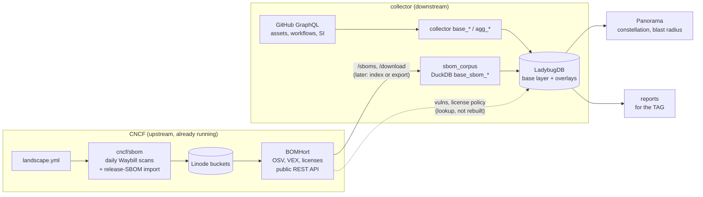
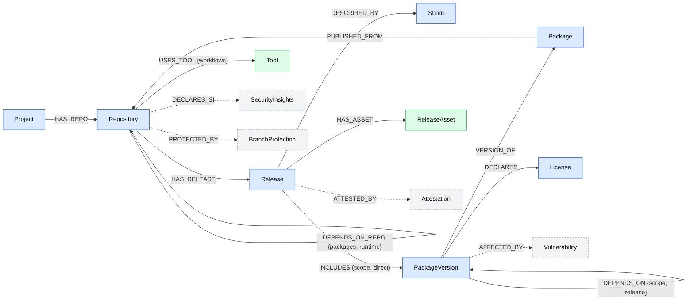
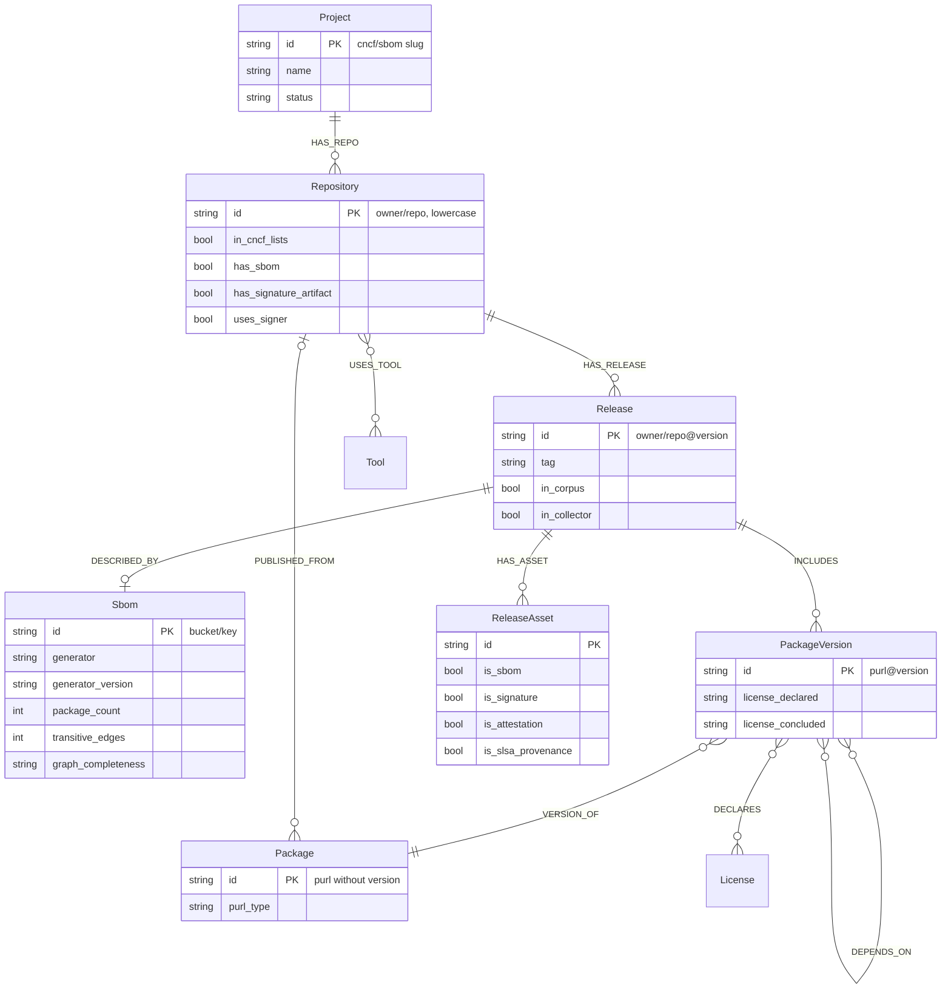
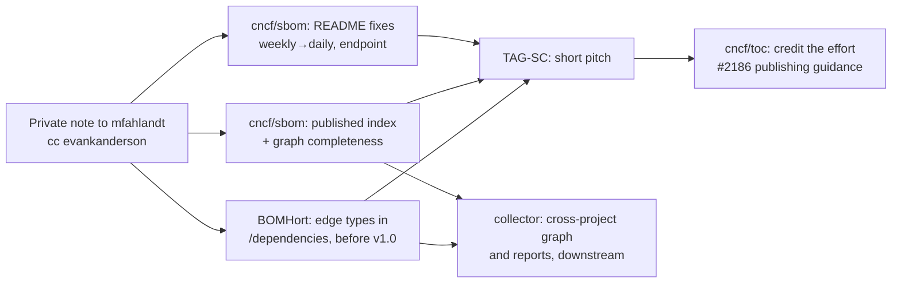

# Pivot: build the supply chain graph from cncf/sbom

**Research spike, 2026-11-27.** CNCF already rebuilds SBOMs with real dependency graphs for about 2,250 CNCF repositories every day ([cncf/sbom](https://github.com/cncf/sbom)) and serves them through a public, read-only API ([BOMHort](https://bomhort.cncf.io)). That corpus should be the base layer of our graph. The collector should stop trying to be an SBOM source and instead add what cncf/sbom does not measure: what projects themselves publish (signatures, attestations, release SBOMs), their CI tooling, and the cross-project analysis nobody has built yet.

A prototype in [`sbom_corpus/`](../../sbom_corpus/README.md) loads 464 SBOMs from both sources into DuckDB and LadybugDB and answers the initiative's blast-radius questions with Cypher.

Detail lives in three appendices:

- [Corpus analysis](cncf-sbom-pivot/corpus.md): pipeline, formats, key layout, fill rates, coverage, freshness, limits.
- [Collector and Panorama today](cncf-sbom-pivot/mapping.md): inventory and entity-by-entity mapping.
- [Gaps and engagement](cncf-sbom-pivot/gaps-and-engagement.md): #1709 goals vs. today, open PRs, owners, first contributions, the TAG pitch.

## What we found

| | Finding | Evidence |
|---|---|---|
| 1 | **The live corpus is reachable, through BOMHort.** `GET /api/v1/sboms` lists 22,214 SBOMs for 2,254 repos (242 projects plus 1,893 subproject folders). `GET /sboms/{id}/download` streams the raw SPDX. No token needed; 100 requests per 10 s per IP. | `bomhort_inventory.parquet`, 2026-11-27 |
| 2 | **The publicly listable bucket is stale and legacy.** The OCI San Jose endpoint in the cncf/sbom README holds 11,028 objects written 2026-03-13 to 05-10, made by `sigs.k8s.io/bom` v0.7.1 (about 97%) and mikebom alphas. No Waybill output. The daily pipeline now writes to Linode buckets that need credentials. | [corpus §1.2](cncf-sbom-pivot/corpus.md#12-formats-key-layout-what-to-key-on) |
| 3 | **The pipeline is alive.** After a bulk ingest in mid-October, 416 to 767 new SBOMs arrive every week through 2026-11-26. | BOMHort `ingested_at` |
| 4 | **Coverage of the landscape is high.** At least one SBOM for 39/41 graduated, 37/38 incubating and 147/160 sandbox projects. 223 of the collector's 266 repos are in the corpus; most of the rest are archived projects cncf/sbom deliberately skips. | prototype, `ref_sbom_repos` |
| 5 | **Release coverage is good and improving.** Of the 4,719 releases in the collector's #120 snapshot, 53% have a cncf/sbom SBOM; of the 964 published in the 60 days before the snapshot, 74%. | prototype join on `owner/repo@version` |
| 6 | **Waybill SBOMs carry a real graph.** 99% of Waybill dependency edges are transitive, with typed build/dev/test/optional scopes. `licenseDeclared` is filled for 86% of packages, checksums for 78%. The old `bom` output is a flat list from the root with no declared licenses. | [prototype results](#prototype-results) |
| 7 | **Old objects are never regenerated.** Of the newest SBOM per project, 170 are Waybill 0.10.0, 50 are Waybill 0.2.0 and 2 are 0.3.0; 19 are project-published syft SBOMs that replaced the scan. Any ecosystem number needs a generator breakdown. | `base_sbom_documents.generator_version` |
| 8 | **Nobody has the cross-project graph.** BOMHort stores one graph per SBOM and answers "who ships package X" and "who is hit by CVE Y". It has no CNCF-project-to-CNCF-project edges and no bulk edge export, and its `/dependencies` endpoint drops relationship types. That is the gap the collector can fill. | [gaps row 8](cncf-sbom-pivot/gaps-and-engagement.md#a-gap-analysis) |
| 9 | **Neither the collector nor Panorama has a dependency edge today.** Panorama's only edges are `BELONGS_TO` and `USES_CI_TOOL`; the "blast radius" idea was dropped for lack of data. | [mapping §2.2](cncf-sbom-pivot/mapping.md#22-panorama-inventory) |

## The pivot

What changes:

1. **cncf/sbom is the SBOM source of record.** We stop inferring SBOM presence from asset names as a headline metric. The collector's asset classification becomes "did the project publish its own", which cncf/sbom does not measure.
2. **Read through BOMHort now; ask for an index or a read key.** The API is enough for a sample and for targeted lookups. A full crawl of a shared production service is not polite. A published index with graph completeness per object (gaps, first contribution 2) would serve everyone, not just us.
3. **Don't rebuild what BOMHort has.** Vulnerability and license-policy answers come from BOMHort. We join them, we don't recompute them.
4. **Add what is missing:** the cross-SBOM dependency graph (project-to-project edges, centrality, blast radius over paths), and overlays for publish-side practice.

## Graph schema

Base layer from cncf/sbom; overlays from the collector (solid) and from BOMHort or future work (dashed).

Design choices worth reviewing:

| Choice | Why |
|---|---|
| Keys are `slug`, `owner/repo`, `owner/repo@version`, purl | These are what cncf/sbom guarantees after post-processing. Bucket folders drop the leading `v`, so the release key does too. GitHub node ids become properties. |
| `DEPENDS_ON` carries `release` | One edge per SBOM that asserts it. Traversals filter on it, so a path never stitches together edges from different SBOMs. Without it, a shortest-path query for Kubernetes 1.37.3 reached `golang.org/x/net` versions that Kubernetes does not use. |
| `PackageVersion` is shared, except unresolved versions | Sharing makes "who uses X@v" one hop. Workspace modules and local packages (`v0.0.0-unknown`, `NOASSERTION`) stay local to their release, or they act as false bridges between unrelated projects. |
| `INCLUDES` separate from `DEPENDS_ON` | Presence questions (CVE impact, license exposure) work even for flat SBOMs, which are still 139 of the 450 preferred SBOMs in the sample. |
| `PUBLISHED_FROM` and `DEPENDS_ON_REPO` | The new edges. A Go module path or `pkg:github` purl resolves to `owner/repo`; when that repo is in cncf/sbom's lists, we get a CNCF-to-CNCF edge. `DEPENDS_ON_REPO` rolls this up to 3,271 edges, small enough for Panorama's Cytoscape and Babylon views. |
| Vulnerabilities as a BOMHort lookup | BOMHort already joins OSV and VEX with scope and depth. Copying 3.6M findings would make us a second vulnerability database. |

## Prototype results

Sample: the newest SBOM per project from BOMHort (242) and from the public bucket (220), plus flux's own release SBOM and cncf/sbom's Waybill tooling scan. One preferred SBOM per release; collector overlays from the #120 snapshot.

| Graph table | Rows | | Graph table | Rows |
|---|---|---|---|---|
| Project | 273 | | INCLUDES | 175,779 |
| Repository | 2,433 | | DEPENDS_ON (per release) | 636,082 |
| Release | 4,492 | | DEPENDS_ON_REPO | 3,271 |
| Sbom | 450 | | PUBLISHED_FROM | 838 |
| Package | 26,653 | | DECLARES | 44,080 |
| PackageVersion | 58,733 | | HAS_ASSET (overlay) | 44,148 |
| License | 405 | | USES_TOOL (overlay) | 666 |

Load takes about 2 minutes into DuckDB and 4 seconds into LadybugDB in a 4-thread cloud container. Only 183 of the 241 BOMHort documents carry the post-processed `pkg:github` root purl; the rest predate post-processing and are attributed from the bucket key and cncf/sbom's repo lists.

Field fill rates by generator (share of non-root packages):

| Generator | Packages | purl | licenseDeclared | licenseConcluded | checksum | supplier | dependency edges transitive |
|---|---|---|---|---|---|---|---|
| Waybill | 122,057 | 94% | 86% | 63% | 78% | 90% | 99% |
| mikebom (legacy) | 32,985 | 100% | 90% | 76% | 92% | 60% | 99% |
| syft (project-published) | 19,225 | 99% | 6% | 18% | 65% | 6% | 100% |
| `sigs.k8s.io/bom` (legacy) | 16,883 | 100% | 0% | 99% | 0% | 0% | **0% (flat)** |

The initiative's questions, as queries (`python -m sbom_corpus query <name>`):

| Question | Query | Sample answer |
|---|---|---|
| Which CNCF repos does everyone depend on? | `most-depended-on` | grpc-go (165 dependents), prometheus/procfs (160), client_golang (159), opentelemetry-go (158), structured-merge-diff (148) |
| CNCF-to-CNCF edges (the constellation) | `cncf-dependencies` | jaeger → opentelemetry-collector (82 packages), jaeger → collector-contrib (43), helm, dapr, zot, opentofu → opentelemetry-go |
| CVE impact / blast radius of package X | `blast-radius` | every project whose newest release includes `golang.org/x/net`, with scope and whether it is direct |
| How does release R reach X? | `blast-radius-paths` | Kubernetes 1.37.3 reaches `x/net` v0.57.0 in one hop from `kube-aggregator`, and v0.51.0 in two hops via `kubelet` |
| License "rug pull" | `license-exposure` | 9 projects ship AGPL-declared packages at runtime scope, e.g. zot and artifact-hub via trivy |
| Overlay: important but unsigned | `unsigned-dependencies` | etcd (51 dependents), containerd (44), distribution (24), cni (20) publish no signature files on their GitHub releases |

The last row needs care. It joins the collector's asset-name detection, which only sees GitHub release assets: Kubernetes signs its artifacts, just not as GitHub release assets. It is a list of where to look, not a finding.

[`notebooks/cncf-sbom-corpus.ipynb`](../../notebooks/cncf-sbom-corpus.ipynb) charts freshness, coverage, generator mix, fill rates and the most depended-on repos with Altair.

## How this relates to open PRs

| PR | Recommendation |
|---|---|
| #120 data snapshot | Merge as planned (after #85, #86, #118). It is the overlay data, and the prototype already joins it. |
| #77 State of the Ecosystem | Revise, then merge as the historical record. Replace §6–7 (GUAC milestone, TAG stewardship) with "what happened next": the final report, cncf/sbom and BOMHort. Reframe Appendix A: those projects have CNCF-generated SBOMs now; what they lack is a *published* SBOM or signature. |
| #84 SBOM publishing recommendations | Revise to "one project-wide SBOM per release, per-artifact SBOMs only in addition" (exact wording in [gaps §B](cncf-sbom-pivot/gaps-and-engagement.md#resolving-84-per-artifact-vs-cncfsbom-one-project-wide-sbom-per-release)), then land the guidance upstream in the cncf/sbom README and cncf/toc#2186. Keep #84 as the evidence. One real edge case: cncf/sbom keeps the *largest* arch-free SBOM, so a Helm chart SBOM can silently replace the project SBOM. |
| #87 tooling survey | Revise with this spike's facts (public API, stale bucket, Linode, dropped edge types), then merge as background. This document supersedes its reuse ranking. |

## Engagement

cncf/sbom and BOMHort are both led by **mfahlandt** (with koksay and jeefy), who is also a TOC liaison to TAG Security & Compliance. In 2025 he suggested the initiative wait for this effort; we declined. Re-engaging should start by saying so, privately, and asking what would help.

The pitch (184 words) is in [gaps §D](cncf-sbom-pivot/gaps-and-engagement.md#d-pitch-for-the-tag-sc-meeting-200-words). Its core: "I'm not proposing a new initiative or tool. I'd like to help with what's already working," followed by three small, specific offers.

Two norms to respect upstream: BOMHort requires DCO sign-off and forbids AI `Co-authored-by` trailers, and both BOMHort and Waybill want an issue before non-trivial PRs.

## Next steps

1. Send the private note (Matt). Nothing else upstream until it is answered.
2. Merge #120; revise #77, #84 and #87 as above.
3. Collector: wire `sbom_corpus` into the collector's output layout and the site export, so Panorama gets `DEPENDS_ON_REPO` and the package tables through the existing manifest.
4. Panorama: a `cncf-constellation-deps` preset on `DEPENDS_ON_REPO`, and a parameterized blast-radius view on the LadybugDB WASM plugin (#161).
5. Switch the loader to the cncf/sbom index or a read key when one exists, and drop the legacy public-bucket path.

## Caveats

- These are CNCF-generated source scans, "NOT official SBOMs" (cncf/sbom README). They see lockfiles, not built artifacts or base images.
- The sample is the newest SBOM per project. Subproject folders (18,373 SBOMs) and history were not loaded; the code handles them (`fetch --strategy latest-per-repo|all`).
- Package-to-repository resolution covers Go and `pkg:github` purls plus a small vanity-path map. npm, PyPI and Maven packages published by CNCF projects are not yet linked; deps.dev can supply that.
- cncf/sbom's subproject discovery mislabels parents by org (all `kubernetes-sigs` repos are filed under Headlamp). The graph uses those lists for `HAS_REPO`, so per-project rollups of subprojects inherit the error.
- Waybill-generated SBOMs could not be produced locally (running the binary was blocked in this environment); all Waybill data here comes from BOMHort.
