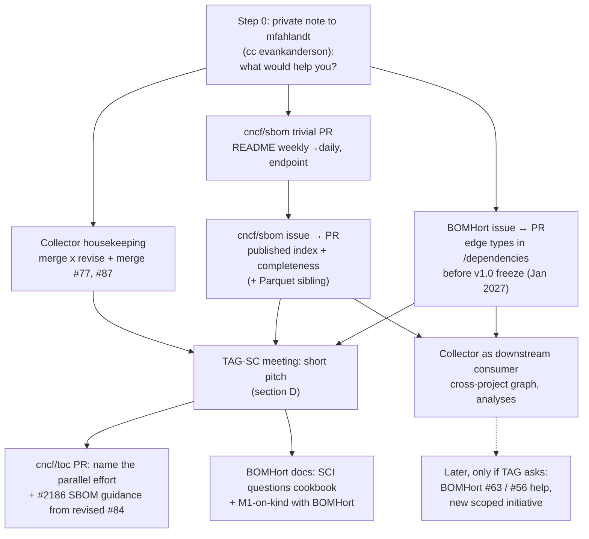

# Gap analysis and engagement path

Researched 2026-11-27 from local clones: cncf/toc (`tags/tag-security-and-compliance`, history to #2320), cncf/sbom (`main`, 2026-11-26), seebom-labs/bomhort (`main`, 2026-11-26), cncf/automation (`ci/cluster/services/apps`), kusari-oss/waybill, and the collector PR branches #77, #84, #87, #120. Live checks against `bomhort.cncf.io` used 16 small requests. "Notes" means the initiative research notes compiled on 2026-11-26 from cncf/toc issues #1709 and #1873–#1880 (not in this repo; the issues are the primary source).

**Short version.** Most of what #1709 set out to do now exists, built by someone else: cncf/sbom rebuilds SBOMs with dependency graphs for about 2,250 CNCF repos every day, and BOMHort serves them, joined to OSV and license policy, at a public read-only API. Both M1 questions can be answered today with BOMHort's existing endpoints. What's missing is narrower: a cross-project dependency graph ("blast radius", "constellation"), corpus-quality reporting, a published index, and TAG-endorsed publishing guidance. All of these are small, and each has an obvious upstream home. The collector fits best as a downstream analysis layer that measures what *projects* publish, which is the one thing cncf/sbom doesn't try to do.

---

## A. Gap analysis

Status key: **Done upstream** (cncf/sbom or BOMHort covers it), **Partial**, **Open**, **Dropped**.

| # | Item (source) | Status today | What cncf/sbom + BOMHort already cover | What remains | Natural owner |
|---|---|---|---|---|---|
| 1 | **Goal:** a unified, queryable view of SBOMs, attestations and vulns for CNCF projects, via hosted GUAC (#1709; Notes#L14) | Partial; GUAC abandoned | BOMHort at bomhort.cncf.io: 22,214 SBOMs, 2,156 projects, 8.57M package rows, 3.63M findings (live `/stats/dashboard`, `/projects`). OSV, VEX, license policy against `exceptions.cncf.io` (automation `bomhort.yaml#L87-89`) | Attestations and signatures are not ingested. OCI-referrer and attestation ingest is BOMHort #525/#143, v1.1.0, Apr 2027 (bomhort `ROADMAP.md#L18`, `#L256`) | BOMHort maintainers |
| 2 | **Exit:** metadata from a defined set of projects in a store (Notes#L18) | Done upstream | cncf/sbom: 239 landscape projects plus ~2,150 discovered subproject repos plus manual and sandbox-application entries (`util/data/*.yaml`; README#L153) | Nothing for SBOMs. Release signatures, provenance and Security Insights are only in the collector | — / collector for publish-side data |
| 3 | **Exit:** demonstrated meaningful queries (Notes#L18) | Partial | `/vulnerabilities/{id}/affected-projects`, `/packages/search`, `/stats/dependencies`, MCP tools `get_affected_projects` and `search_packages` (bomhort `docs/content/docs/mcp/_index.md#L34-40`) | A short, reproducible query cookbook that answers the M1 questions against the CNCF instance | halcyondude, in BOMHort docs or a TAG doc |
| 4 | **Exit:** documented architecture, sources, methods (Notes#L18) | Partial | cncf/sbom README (pipeline, bucket layout, post-processing); BOMHort architecture docs | One page that describes cncf/sbom → buckets → BOMHort as the reusable "template" the initiative Objective asked for (toc `supply-chain-insights/README.md#L7`), including how to run it elsewhere (BOMHort `make kind-up`) | halcyondude, reviewed by mfahlandt |
| 5 | **M1 Q:** which projects are hit by a CVE in library X (toc README#L55) | Done upstream | `affected-projects` returns per-SBOM matches with `dependency_scope` and `dependency_depth` (live check: CVE-2024-27304 → artifact-hub 1.14.0, transitive, depth 2). Scope comes from `025_add_dependency_depth` | Version-range and "fixed-in" search is #63, Blast Radius Search, v1.2.0, Jul 2027 (`ROADMAP.md#L281`). VEX is empty on the CNCF instance (`total_vex_statements: 0`) | BOMHort (#63); projects for VEX |
| 6 | **M1 Q:** which projects are hit if library X re-licenses ("rug pull") (toc README#L54) | Partial | `/packages/search?q=` returns `project_count` and versions per purl (live: `golang.org/x/crypto` → 906 projects). Per-package license and license source are recorded | A hypothetical "if X became non-OSI" query that excludes dev/test-only paths. BOMHort records scope as depth, but the dependency API drops relationship types (see "BOMHort API as a data source" below), so a consumer can't separate `DEV_DEPENDENCY_OF` from runtime | BOMHort (API field); cookbook by halcyondude |
| 7 | **M1 further Q:** which libraries would cause the largest impact (toc README#L57-59) | Partial | `/stats/dependencies`: top packages by `project_count` across 48,377 unique deps | Ranking by dependents' maturity and by graph centrality (paths, not presence). Needs the cross-SBOM graph | halcyondude (collector graph), downstream |
| 8 | **#1873 blast radius:** what breaks if X changes (Notes#L26) | Open | Each SBOM's graph is stored as index arrays (`002_create_sbom_packages.up.sql`); `/sboms/{id}/dependencies` returns children per node | There is no graph across SBOMs: CNCF-project → CNCF-project edges (root purl `pkg:github/...` vs. module purl `pkg:golang/...`), and no bulk edge export. BOMHort plans a per-SBOM tree view (#56) and search (#63), not an ecosystem graph | Export: BOMHort. Ecosystem graph: halcyondude (collector/LadybugDB) |
| 9 | **Constellation view:** "fly around" the CNCF graph (#1709; Notes#L7) | Open | Fleet tree views (cluster → namespace → project) | Everything. #1709 kept a user-facing dashboard out of phase one anyway (Notes#L17) | halcyondude, downstream, not a TAG deliverable |
| 10 | **M1:** GUAC on a single-node kind cluster ingesting the SBOMs of what runs there (toc README#L52) | Dropped / superseded | BOMHort ships `make kind-up` (bomhort `README.md#L54`) and a reference cluster scanner (#539, v1.1.0) | One how-to: "M1 on kind with BOMHort", ingesting a cluster's images and answering Q5 and Q6. This is the cheapest honest closure of M1 | halcyondude, upstream in BOMHort `examples/kind` |
| 11 | **#1878:** discover published security artifacts (Notes#L32) | Done upstream for SBOMs | cncf/sbom importer: content sniffing, project-wide vs. per-binary classification, SPDX 2/3 and CycloneDX (README#L565-616; `util/sbom-lib.sh#L90-133`) | There is no published index of the corpus: `generate-index` only writes `sbom/index.json` for a local tree (README#L334-347), and no workflow uploads one. Signatures and Security Insights are not discovered | cncf/sbom (index); collector (signatures, SI) |
| 12 | **#1879:** graph creation, enrichment, aggregation, federation (Notes#L33) | Partial | Creation and enrichment (deps.dev, ClearlyDefined, OSV) done upstream | Aggregation across SBOMs and federation, as in row 8 | Same as row 8 |
| 13 | **#1880:** air-gapped GUAC via zarf (Notes#L33) | Dropped | — | Nothing; leave it closed | — |
| 14 | **#1876:** CRA education (Notes#L29) | Dropped | BOMHort is now CRA-driven: vulnerability register in v0.9.0, CRA dashboard in v1.0.0 (`ROADMAP.md#L15-17`) | Nothing for this initiative | — |
| 15 | **Finding 1:** published SBOMs are hard to find and uneven; flat lists, no tree (toc README#L17-19) | Mostly done upstream | cncf/sbom stops relying on published SBOMs: it rebuilds with Waybill, extracts real edges, normalises roots (README#L29-33, #L540-563). Waybill writes `waybill:graph-completeness` (README#L529) | (a) Old objects are never regenerated. The planner only fills missing `(repo, tag)` pairs (README#L153). Live sample: apicurio-registry 3.2.0 is still Waybill **0.2.0**, document name `tmp.tqx5e2f5se`, root purl `pkg:generic/...`, so the post-processing guarantee doesn't hold for that object. (b) Nothing reports graph completeness across the corpus. (c) BOMHort's quality score doesn't read the Waybill completeness annotation | cncf/sbom (backfill/regenerate); BOMHort (#537 quality); report by halcyondude |
| 16 | **Finding 2:** GUAC/GraphQL unsuitable for analytics (toc README#L21-23) | Done upstream | BOMHort on ClickHouse | Process step 2, "feedback to GUAC" (toc README#L35), was never written down. mlieberman85 maintains Waybill and is at Kusari, which also backs GUAC | halcyondude: one short written note |
| 17 | **Finding 3:** CI too divergent for one tooling fix (toc README#L25-27) | Sidestepped upstream | Rebuilding from source makes CI divergence irrelevant for CNCF's own corpus | Guidance for projects that still want their own SBOM to be the one used: TAG-endorsed, aligned with cncf/sbom rules | jkjell via cncf/toc#2186 (Notes#L95); halcyondude contributes (#84) |
| 18 | **Finding 4:** a parallel CNCF-staff effort did "substantially more" (toc README#L13) | Done, not credited by name | It is cncf/sbom + BOMHort (mfahlandt, koksay, jeefy) | The final report doesn't name it. A one-line cncf/toc PR adding links, with mfahlandt's consent | halcyondude; evankanderson approves |
| 19 | **Process 1:** is a community-operated analysis platform worth a subproject? (toc README#L33) | Open, implicitly answered | The platform exists as cncf/sbom + BOMHort chart + cncf/automation Argo app | Record the answer: no new subproject; the template is the existing stack | evankanderson / TAG chairs |
| 20 | **Process 3:** patterns for projects to publish supply chain metadata (toc README#L37) | Partial | cncf/sbom "Best practice for projects publishing their own SBOM" (README#L618-650) | TAG endorsement, signing and Security Insights pointers, discovery contract. That is collector #84, which should land upstream instead of as a parallel doc | jkjell (#2186), mfahlandt (cncf/sbom README); halcyondude drafts |

### BOMHort API as a data source

**Access.** The REST API on `bomhort.cncf.io` is public and read-only. The CNCF deployment sets no `AUTH_ENABLED` (automation `bomhort.yaml`), so the auth middleware is a pass-through (`backend/cmd/api-gateway/main.go#L1591-1594`). Writes are refused anyway when auth is off: upload at `#L1846-1850`, evidence at `#L447-449`. `/mcp` returns 401 because it needs a bearer token from the `bomhort-mcp` secret (`bomhort.yaml#L90-97`).

**Limits.**
- `page_size` defaults to 50 and is clamped to 500 (`main.go#L1357-1362`).
- `/packages/search` and `/packages/detail` parse `page_size` without the clamp (`main.go#L901`, `#L919`). The search query defaults to 20.
- Rate limit: 100 requests per IP per 10 s by default (`internal/config/config.go#L277`, `main.go#L1495-1508`). The CNCF values don't override it.
- No rate-limit headers are returned. Responses come through nginx.

**Where ingestion reads from.** Three buckets on Linode Object Storage `https://us-iad-18.linodeobjects.com`: `cncf-project-sboms`, `cncf-subproject-sboms` and `sandbox-reviews` (`bomhort.yaml#L67-86`). BOMHort reads them with credentials that can't write (automation commit `b6c7e88`); `originalStore.backend: none`.
- From this sandbox, the Linode endpoint didn't connect. The publicly listable OCI San Jose bucket (the endpoint shown in cncf/sbom README#L270) holds 11,028 legacy objects (bom v0.7.1, mikebom alpha, Mar–May 2026) and no Waybill 0.10 output.
- So BOMHort's copy (22,214 SBOMs) is the current one. The public bucket is stale, and the docs point at the wrong endpoint for the current data.

**Routes** (all in `backend/cmd/api-gateway/main.go`; line = registration):

| Route | Line | Params | Returns |
|---|---|---|---|
| `GET /api/v1/sboms` | 207 | `page, page_size, search, project, origin, min_quality, image, digest` | `{data:[{sbom_id, source_file (s3://bucket/key), spdx_version, document_name, document_version, package_count, vuln_count, ingested_at, source_repo, source_ref, project}], total, page, page_size}` (live: total 22,214) |
| `GET /api/v1/sboms/{id}/detail` | 384 | — | the row above plus `critical/high/medium/low_vulns` |
| `GET /api/v1/sboms/{id}/dependencies` | 363 | — | **the per-SBOM graph**: an array of `{index, spdx_id, name, version, purl, license, license_source, children:[index], dependency_scope (root/direct/transitive/unknown), dependency_depth}`. Not paginated (apicurio 3.2.0: 2,904 nodes, 18,420 child links). **Relationship types are dropped** (`internal/clickhouse/queries.go#L897-903`) even though they are stored in `rel_types` |
| `GET /api/v1/sboms/{id}/download` | 1099 | — | **the raw SBOM**, streamed from the bucket (live: 200, 11.9 MB SPDX JSON) |
| `GET /api/v1/sboms/{id}/vulnerabilities` | 407 | `scope, reachability, exploit, cwe` | findings for one SBOM |
| `GET /api/v1/sboms/{id}/licenses`, `/notices`, `/vex` | 496, 512, 481 | — | license breakdown, NOTICE text, VEX |
| `GET /api/v1/projects` | 566 | `page, page_size, tag, group_by=parent` | `{data:[{project_name, sbom_count, package_count, vuln_count, latest_ingested, latest_sbom_id, tags}], total}` (live: 2,156) |
| `GET /api/v1/projects/{name}` | 659 | — | rollup: severities, `license_breakdown`, `latest_version`, `source_repo`, parents |
| `GET /api/v1/projects/{name}/sboms`, `/vulnerabilities`, `/packages`, `/notices` | 683, 700, 728, 747 | `page, page_size` (+ vuln filters) | per-project lists |
| `GET /api/v1/vulnerabilities` | 300 | `page, page_size`, filters | `{data:[{vuln_id, cve_id, aliases, severity, purl, summary, fixed_version, source_file, discovered_at, dependency_scope}], total}` (live: 3.63M) |
| `GET /api/v1/vulnerabilities/{id}/affected-projects` | 800 | — | `[{sbom_id, source_file, document_name, purl, package_name, version, severity, is_direct, dependency_scope, dependency_depth}]`: **CVE impact** |
| `GET /api/v1/reports/vulnerabilities` | 303 | `format=csv, scope` | streamed CSV export |
| `GET /api/v1/packages/search` | 893 | `q, page, page_size` | `{total_results, items:[{package_name, purl, project_count, versions}]}`: **who ships X** |
| `GET /api/v1/packages/detail` | 912 | `name, page, page_size` | the SBOMs and projects that contain a package |
| `GET /api/v1/stats/dependencies` | 821 | `limit` | `{total_unique_deps, top_dependencies:[{package_name, purl, project_count, versions, vuln_count}]}` |
| `GET /api/v1/stats/dashboard`, `/stats/quality`, `/stats/version-skew` | 187, 847, 833 | — | instance totals, quality-score distribution, version skew |
| `GET /api/v1/licenses/compliance`, `/sources`, `/discrepancies`; `/projects/license-compliance` | 318–340, 539 | — | license views |
| `GET /api/v1/license-policy`, `/license-exceptions` | 875, 872 | — | the policy in force |
| `GET /api/v1/packages/archived`, `/archived/repos` | 880–881 | — | dependencies on archived upstream repos |
| `GET /api/v1/search`, `/tags`, `/origins`, `/fleet`, `/clusters…`, `/namespaces…`, `/images…`, `/vex/statements` | various | `page, page_size` | navigation and fleet views |
| `GET /api/v1/tea/…`, `/.well-known/tea` | 1194 | — | Transparency Exchange API (products, releases, artifacts, downloads) |
| `GET /api/v1/badges/projects/{name}/{vulnerabilities,licenses}.svg` | 778, 791 | — | badges |
| `POST /api/v1/sboms/upload`, `POST /sboms/{id}/evidence`, `PATCH /sboms/{id}` | 1170, 446, 1182 | — | writes, refused on this instance |

**What this means for the collector.**
- Per-SBOM graphs and raw documents are available without credentials. A full crawl isn't a good idea: 22,214 SBOMs × (dependencies + download), at up to 12 MB each, against a shared CNCF instance limited to 100 req/10 s.
- Ask mfahlandt for one of two things: read credentials for the Linode buckets, or a published index plus a bulk Parquet/JSONL export (row 11).
- Until then, use the API for targeted lookups only.
- If edge direction matters, read `/download`, not `/dependencies`. In the sample, 861 child links point back at the root. These match SPDX `*_DEPENDENCY_OF` relationships whose target is the root (test/dev/build/optional deps of the root), which the children view shows as the root being their child.

---

## B. Open collector PRs and the pivot

| PR | What it is | Recommendation | Why |
|---|---|---|---|
| **#120** data snapshot 2026-11-26, 266 repos (draft) | Fresh Parquet + landscape input from `collect.yml` run 45786946031; the body says merge after #85, #86, #118 | **Merge as-is** once #85/#86/#118 are in | #77 and #84 cite its commit `0078e02` for every figure. It measures what projects *publish* (release assets, signatures, Security Insights, CI tools), which cncf/sbom deliberately doesn't. Keep the existing caveat that `base_branch_protection_rules` is empty |
| **#77** State of the Ecosystem (the #1874 deliverable) | §1–5 + Appendix B are solid, reproducible, lower-bound data. §6 asks to greenlight GUAC M1 and #1879 federation; §7 asks for TAG stewardship | **Revise, then merge** as the historical record. **Supersede §6–7** | §6–7 contradict the final report (GUAC dropped, initiative closed). Replace them with a short "What happened next": final report, cncf/sbom + BOMHort, and the publish-side data the collector still adds. Reframe Appendix A (27 graduated projects): all of them now have CNCF-generated SBOMs in BOMHort, so the finding is "project-*published* SBOM/signature absent from GitHub releases", not "no SBOM". Tone down "We chartered…", "That's the win" and "an order of magnitude past the pilot" |
| **#84** SBOM publishing recommendations | Already partly realigned on 2026-11-26 (commits `fc07516`, `6058e8f`) to "project-wide plus per-artifact" | **Revise, then fold into the pivot.** Upstream the guidance; keep the collector doc as the data appendix | A second recommendations doc next to cncf/sbom README#L618-650 reads as competing. Split it: (1) a PR to the cncf/sbom README's best-practice section with the additive items it lacks (format in filename, sign the SBOM, Security Insights pointer, discovery contract); (2) input to cncf/toc#2186 for contribute.cncf.io; (3) #84 stays as the evidence. Wording below |
| **#87** survey of cncf/automation + cncf/sbom tooling | Good inventory and reuse plan | **Revise, then merge.** It becomes the pivot's design note | Update it with the facts confirmed since: the BOMHort REST API is public (22,214 SBOMs); the public OCI bucket is stale and legacy; the current copy is on Linode with credentials; `/dependencies` drops edge types; some objects predate post-processing. Its #84-conflict row is outdated now that #84 says "publish both". Reorder its reuse list: the BOMHort API and a requested bucket key or export come first, and "align matcher with cncf/sbom" stays |

### Resolving #84 (per artifact) vs. cncf/sbom (one project-wide SBOM per release)

There is no real conflict over *intent*. cncf/sbom rule 6 says "one SBOM per release, not per component" but welcomes per-binary SBOMs "in addition" (README#L623-626, #L643-645). BOMHort ingests only the project-wide object and skips `_release_*` keys (bomhort `ROADMAP.md#L105`, `backend/internal/s3/client.go#L351-360`).

The real problem is a classification edge case that #84 doesn't mention. cncf/sbom treats *any* SBOM-named JSON asset without an OS/arch token as project-wide and keeps the **largest** one (`util/sbom-lib.sh#L91`, `#L109`). A per-artifact SBOM for an architecture-neutral artifact (Helm chart, multi-arch image index, jar, wasm, source tarball) has no token. If it's bigger than the real project-wide SBOM, it replaces both the project's SBOM and CNCF's scan.

Proposed replacement for #84 recommendation 3:

> ### 3. One project-wide SBOM per release; per-artifact SBOMs only in addition
>
> - **Required:** one project-wide SPDX 2.3 JSON SBOM per release, generated from the source tree at the tag, attached to the GitHub release of that tag and named `<project>_<version>_sbom.spdx.json` (no OS or architecture token). This is the release's SBOM of record. CNCF's pipeline ([cncf/sbom](https://github.com/cncf/sbom#best-practice-for-projects-publishing-their-own-sbom)) imports it in place of its own Waybill scan, and [BOMHort](https://bomhort.cncf.io) shows it.
> - **Optional:** per-artifact SBOMs for binaries and archives, named `<artifact-file-name>.spdx.json`, for example `foo_1.4.0_linux_amd64.tar.gz.spdx.json`. They describe one build for one platform. cncf/sbom keeps the largest as a secondary `*_release_spdx.json`; BOMHort does not ingest it. Publish them in addition to the project-wide SBOM, never instead of it.
> - **Keep exactly one OS/arch-free SBOM asset per release.** SBOMs for architecture-neutral artifacts (Helm charts, multi-arch image indexes, jars) belong on the artifact itself, as an OCI attestation (recommendation 7). Don't attach them as release assets, because cncf/sbom would treat them as project-wide candidates.
> - **Never archive SBOMs** (`sbom.tar.gz`), and don't use tag-value or XML for the release asset; they are ignored.

Two related fixes in #84:
- The Security Insights example (`pr84:docs/sbom-publishing-recommendations.md#L91`) points `location` at `<project>.spdx.json`, but its comment says "one SPDX SBOM per release archive, named `<archive>.spdx.json`". Make it point at the project-wide file.
- File a matching cncf/sbom issue asking the importer to prefer an explicit project-wide name (`*_sbom.spdx.json`, or a Security Insights declaration) over "largest arch-free file". This would make the rule robust without changing what projects do today.

---

## C. Engagement path

### Who owns what (from git, OWNERS, CODEOWNERS, MAINTAINERS)

| Thing | Owners / maintainers | Evidence |
|---|---|---|
| **cncf/sbom** | **mfahlandt**: 59 of 66 human commits and every merged PR except one (#1–#5, #39). Also **jeefy**, **mrbobbytables** (#30), Koray Oksay (**koksay**), arpitjain099. No OWNERS or CODEOWNERS file; README Contributing is just "fork, test locally, PR" (README#L685-692) | `git shortlog`, merge subjects |
| **BOMHort** (seebom-labs, OpenSSF Sandbox) | **mfahlandt** (project lead), **koksay**. OWNERS approvers and reviewers are just those two. The top recent committer is vishnums2k5 (contributor). jeefy's issues set priority as a "consumer" (ROADMAP#L21) | `MAINTAINERS.md`, `OWNERS`, `.github/CODEOWNERS` |
| **bomhort.cncf.io deployment** | **koksay** (every recent change to `bomhort.yaml`), **mfahlandt**. cncf/automation approvers: jeefy, idvoretskyi, RobertKielty, mfahlandt, mrbobbytables | `git log -- ci/cluster/services/apps/bomhort.yaml`, `OWNERS` |
| **Waybill** (kusari-oss) | **mlieberman85** (sole maintainer and CODEOWNER, 28 of 30 recent commits); Tim Miller (handle not confirmed) | `MAINTAINERS.md`, `CODEOWNERS` |
| **SCI initiative** | OWNERS: brandtkeller, evankanderson, halcyondude, jpower432, krol3. #2320 author and liaison: **evankanderson** | `initiatives/supply-chain-insights/OWNERS`, commit `fce30da` |
| **TAG Security & Compliance** | Chairs **evankanderson**, **jkjell**, **mnm678**. TLs arewm, JustinCappos, zigmax, sherine-k, realshuting, y-tabata. TOC liaisons **angellk**, **mfahlandt** | TAG `README.md` |
| **contribute.cncf.io SBOM/SLSA guidance** | **jkjell** (cncf/toc#2186, open) | Notes#L95 |

mfahlandt is the hub. He leads cncf/sbom and BOMHort and is a TOC liaison to this TAG. In 2025 he and jeefy suggested the initiative wait for their effort, and Matt declined to depend on it (Notes#L20). The re-engagement should say that plainly.

### Where to contribute first (small and likely welcome)

1. **cncf/sbom, trivial PR:** README#L17 says generation "runs weekly"; the cron is daily (`generate-sbom.yml#L6`, README#L141). Also update the storage example endpoint (README#L270, OCI San Jose) to match what consumers actually read (Linode, `bomhort.yaml#L70`), or explain the two.
2. **cncf/sbom, issue first, then PR:** publish a corpus index to the bucket on each run. `generate-index` already exists but only runs locally (README#L334-347). Per object, add `waybill` version, `waybill:graph-completeness`, package and edge counts, and `imported`/`generated`. That also gives a **graph-completeness report** and shows which objects need regenerating (row 15). Offer a Parquet sibling of the index; that is the collector's skill set.
3. **cncf/sbom, issue:** objects that predate post-processing or Waybill 0.10 (e.g. apicurio-registry 3.2.0 from Waybill 0.2.0, `pkg:generic` root). Ask whether a backfill with `force_regenerate`, or re-running `postprocess-spdx.sh` on published objects (README#L561-563), is wanted.
4. **BOMHort, issue, then small additive PR:** expose relationship types in `GET /sboms/{id}/dependencies`, e.g. `children_types` parallel to `children`, or an `edges` array. Then propose a bulk edge export (`?format=jsonl` per project). This fits the "consumer-raised ships first" rule (ROADMAP#L21) and should be raised before the v1.0.0 response-shape freeze (Jan 2027, ROADMAP#L17). Later: offer help on #63 Blast Radius Search and #56 Tree View (v1.2.0), and on reading `waybill:graph-completeness` into the #537 quality score.
5. **BOMHort docs:** "Answering the SCI questions" (rows 3, 5, 6, 10): CVE impact and license rug-pull with REST/MCP examples, plus the M1-on-kind walkthrough.
6. **cncf/toc, one-line PR** to the SCI README: name cncf/sbom + BOMHort as the parallel effort and link them (row 18). Only after mfahlandt agrees; evankanderson approves.
7. **cncf/toc#2186:** offer the revised #84 text as the SBOM-publishing section for contribute.cncf.io, aligned to the cncf/sbom rules, with collector data as evidence.
8. **Collector (own lane):** consume the BOMHort API or index into DuckDB/LadybugDB to build the cross-project graph, then publish analyses (most-central libraries, CNCF→CNCF dependencies) as reports. Don't run a hosted service.

### Sequencing

Don't put dates on anything after step 0. Commit to the next one or two items at a time.

### Risks

- **Looks like a competing tool.** The collector already has its own SBOM guidance (#84), its own graph and its own site. Mitigations:
  - Never describe it as an SBOM platform.
  - Land guidance upstream (cncf/sbom README, #2186).
  - Credit cncf/sbom + BOMHort by name.
  - Contribute code to their repos before showing collector features at the TAG.
  - Restrict the collector to what they don't do: publish-side measurement and cross-project analysis.
- **Scope creep.** Constellation, Panorama, federation and attestation ingest are each larger than everything above. Keep them out of TAG asks. In particular, attestations are already planned in BOMHort v1.1.0 (#525, #143), so don't build a parallel version.
- **Egress and data access.**
  - The only public bucket (OCI San Jose) is stale and legacy, and the current Linode copy needs credentials.
  - The public BOMHort API is a shared production service with a 100 req/10 s per-IP limit, unpaginated graph responses and multi-MB downloads.
  - Ask for a read key or published export. Don't crawl. Cache locally, and keep the request budget in the collector config.
- **Data-quality claims.** The corpus mixes Waybill versions and some objects lack post-processing. Any ecosystem-level number from it needs a generator-version breakdown, or it repeats the "every number is a lower bound" problem with new data. The same goes for naming projects (Appendix A of #77): keep the correction loop.
- **Contribution norms.**
  - BOMHort's AI policy welcomes AI-assisted work but requires DCO sign-off, forbids `Co-authored-by` AI trailers, and expects the submitter to explain and maintain every change (`docs/content/docs/development/ai-policy.md`). Strip collector-style AI attribution from upstream commits.
  - Waybill and BOMHort both ask for an issue before non-trivial changes (`CONTRIBUTING.md`).
- **Maintainer bandwidth and timing.** BOMHort is mid-way through the CRA register (v0.9.0) and heading to the v1.0.0 freeze. Small, additive, consumer-motivated asks fit; design debates don't.
- **Capacity.** Health limited delivery last time. Prefer items that are useful even if nothing follows them (a fixed README, an index, a doc page), and avoid anything that creates an ongoing operational duty.

---

## D. Pitch for the TAG-SC meeting (≤200 words)

> Last year I led the Supply Chain Insights initiative. Health problems kept me from finishing it. Evan closed it with an honest final report, and I agree with it: published SBOMs weren't good enough, and GUAC wasn't the right store for analytics.
>
> Meanwhile Mario, Koray and Jeffrey built the thing we were reaching for. cncf/sbom rebuilds SBOMs with real dependency graphs for about 2,250 CNCF repos every day, and BOMHort serves them at bomhort.cncf.io. Both of our Milestone 1 questions, CVE impact and license "rug pull", can be answered with BOMHort's API today.
>
> So I'm not proposing a new initiative or tool. I'd like to help with what's already working:
>
> 1. In cncf/sbom: a published corpus index with graph-completeness per SBOM, if the maintainers want it.
> 2. In BOMHort: relationship types in the dependency API, and a short doc showing how to answer the SCI questions.
> 3. Here: fold my SBOM-publishing data into the contribute-site guidance (#2186), aligned with cncf/sbom's rules.
>
> My collector stays a downstream consumer that measures what projects publish themselves. I'll take one item at a time and report back here.
