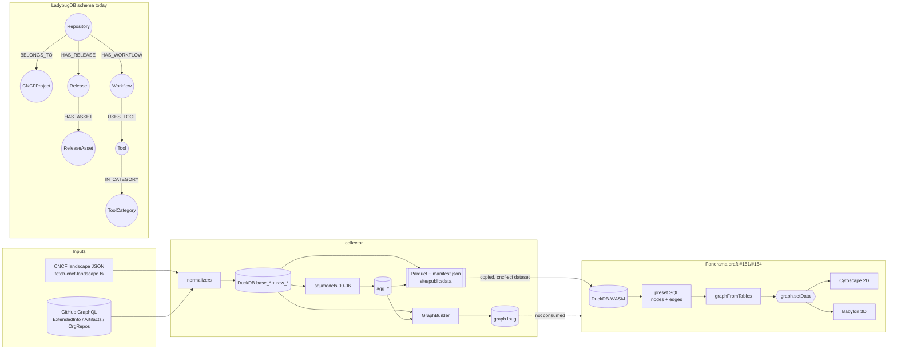

# Collector and Panorama today, mapped onto a cncf/sbom-first model

Citation format: `repo@branch:path#Lnn`. Repos: `collector` = halcyondude/supply-chain-security-collector, `panorama` = dreamteam-hq/panorama, `sbom` = cncf/sbom. Unmerged work is cited by its PR head branch. Collector PR chain: #86 `fix/graph-release-load` → #118 `fix/workflow-tool-detection` (stacked on #86); #120 `data/landscape-2026-11-26` (data only). Panorama chain: #149 `fix/148-context-key-mismatch` → #151 `feat/dataset-preload-sci-explorer` (draft) → #164 `feat/129-babylon-shell` (draft, superset of #151). All of these are still open.

## Summary

- **Neither repo has a package dependency edge anywhere.** The collector's graph holds repository, release, asset and workflow nodes plus CI tools. It has no Package or Dependency node and no DEPENDS_ON edge. Panorama builds its graphs from the collector's Parquet files in DuckDB-WASM, so it inherits the same gap.
- **There is no "blast radius" view in Panorama.** The closest thing is `preset:cncf-ci-tool-adoption`. It replaced a "Tool blast radius" idea that was dropped, and its own description says "not dependency blast radius" (`panorama@feat/129-babylon-shell:packages/plugin-view-engine/src/lib/dataset-presets.ts#L331-L346`).
- **cncf/sbom supplies what is missing:** per-release Package nodes keyed by purl, typed dependency edges, licenses, and a root purl `pkg:github/<owner>/<repo>@<tag>`. Most of the collector's practice signals have no counterpart in an SBOM. They should be kept as an overlay joined on `owner/repo` and on tag/version.

---

## 2.1 Collector inventory (main)

### GraphQL queries

| Query | Fetches | Notes |
|---|---|---|
| `GetRepoDataExtendedInfo` (default, `collector@main:src/neo.ts#L79`) | repo id/name/url/description; `licenseInfo{key,name,spdxId}`; `hasVulnerabilityAlertsEnabled`; default-branch `branchProtectionRule` and `branchProtectionRules(first:10)`; `HEAD:SECURITY.md`; `HEAD:.github/dependabot.yml`; `releases(first:20)` with `releaseAssets(first:50){id,name,downloadUrl}`; `HEAD:.github/workflows` tree with blob text; 4 Security Insights paths (`collector@main:src/graphql/GetRepoDataExtendedInfo.graphql#L58-L186`) | The `dependabot.yml` blob is fetched but never normalized. `base_security_md` is always empty (`collector@main:src/normalizers/GetRepoDataExtendedInfoNormalizer.ts#L241`). |
| `GetRepoDataArtifacts` | repo id/name; `releases(last:5)` with assets (`collector@main:src/graphql/GetRepoDataArtifacts.graphql#L1-L26`) | A lighter subset of the query above. |
| `GetOrgRepos` (`--scan-orgs`, `collector@main:src/neo.ts#L85`) | every public repo in an org: id, name, isArchived, isFork, default branch, top 5 languages (`collector@main:src/graphql/GetOrgRepos.graphql#L1-L31`) | Used for discovery and visibility only. |

### Tables

`raw_<QueryName>` holds the full JSON responses (`collector@main:src/ArtifactWriter.ts#L48-L60`). Every base table is exported to `parquet/<table>.parquet` (`#L674-L696`).

| Table | Key columns / properties | Source |
|---|---|---|
| `base_repositories` | id (GitHub node id), name, nameWithOwner, url, description, hasVulnerabilityAlertsEnabled, license_key/name/spdxId, defaultBranch_name | `collector@main:src/normalizers/GetRepoDataExtendedInfoNormalizer.ts#L17-L31` |
| `base_branch_protection_rules` | repository_id, allowsDeletions, allowsForcePushes, dismissesStaleReviews, isAdminEnforced, requiresStatusChecks/Strict, requiresCodeOwnerReviews, requiredApprovingReviewCount, pattern, isDefaultBranch | `…Normalizer.ts#L33-L47`. Has 0 rows in every shipped snapshot because the token lacks admin access. |
| `base_releases` | id, repository_id, name, tagName, url, createdAt | `…Normalizer.ts#L49-L57` |
| `base_release_assets` | id, release_id, name, downloadUrl | `…Normalizer.ts#L59-L65` |
| `base_workflows` | id, repository_id, filename, content (YAML) | `…Normalizer.ts#L68-L74` |
| `base_security_md` | repository_id, path, content | Always empty (see above). |
| `base_si_documents` | repo_id, source_url, schema_version, document JSON | `collector@main:src/ArtifactWriter.ts#L345-L353` |
| `base_si_sboms` | repo_id, sbom_format, sbom_url, sbom_file, sbom_comment (from SI `dependencies.sbom[]`) | `collector@main:sql/models/01a_security_insights_flattener.sql#L247-L282` |
| `base_cncf_projects` | project_name, display_name, maturity, category, subcategory, date_accepted/incubating/graduated/archived, homepage/repo/docs URLs, url_for_bestpractices, clomonitor_name, has_security_audits, security_audit_count, latest_audit_date/vendor, parent_project, tag_associations, annual_review_*, license, … (37 columns) | `collector@main:src/ArtifactWriter.ts#L480-L568` |
| `base_cncf_project_repos` | project_name, owner, name, primary, branch | `collector@main:src/ArtifactWriter.ts#L570-L600` |
| `base_org_repos` | cncf_project_name, org, nameWithOwner, isArchived, isFork, primary language | `collector@main:src/ArtifactWriter.ts#L604-L662` |

`project_name` is the landscape name with every character outside `[A-Za-z0-9-_. ]` removed (`collector@main:scripts/fetch-cncf-landscape.ts#L255`). It is not the cncf/sbom slug, but `slug(project_name) == slug(landscape name)`, because every character it removes is one the slug drops anyway.

| agg / model table | What it holds | File |
|---|---|---|
| `agg_artifact_patterns` | Per release asset: is_sbom, sbom_format (spdx/cyclonedx/unknown), is_signature (.sig/.asc/.pem/.pub), is_attestation, is_vex, is_slsa_provenance, is_in_toto_link/layout, is_sigstore_bundle, is_swid_tag, is_container_attestation, is_license_file. Detected by asset-name FTS or regex. | `collector@main:sql/models/01_artifact_analysis.sql#L14-L58` |
| `agg_si_attestations` | Flattened Security Insights attestations (release, tool_adhoc/ci/release, top_level, security_artifacts) | `collector@main:sql/models/01a_security_insights_flattener.sql#L29-L235` |
| `agg_workflow_tools` | (workflow_id, repository_id, tool_category, tool_name). Categories: sbom-generator, signer, goreleaser, vulnerability-scanner, dependency-scanner, code-scanner, container-scanner. | `collector@main:sql/models/02_workflow_tool_detection.sql#L16-L165` |
| `agg_repo_summary` | Per repository: has_sbom/signature/attestation_artifact, …, uses_<category>, uses_<tool> (syft, trivy, cdxgen, cosign, sigstore, slsa_github_generator, snyk, dependabot, renovate, codeql, grype), counts, sbom_adoption_rate, first_sbom_date | `collector@main:sql/models/03_repository_security_summary.sql#L14-L174` |
| `agg_executive_summary`, `agg_tool_summary`, `agg_repo_summary_sorted`, `agg_sbom_summary`, `agg_advanced_artifacts`, `agg_tool_category_summary`, `agg_repo_detail` | Rollups for reports | `collector@main:sql/models/04_summary_views.sql#L25-L168` |
| `agg_cncf_project_summary` | Per project: repo and adoption counts plus landscape metadata (audits, clomonitor_name, dates) | `collector@main:sql/models/05_cncf_project_analysis.sql#L18-L177` |
| `agg_org_summary` | Per org: repos in or out of the landscape, archived, forks | `collector@main:sql/models/06_org_ci_visibility.sql#L17-L30` |

**Bug on main:** two `create_fts_index('base_workflows', …, overwrite=1)` calls, on `content` and then on `filename`. The second replaces the first, so CI-tool detection on main matches workflow *file names* only (`collector@main:sql/models/00_initialize_indexes.sql#L20-L23`). PR #118 fixes this with a single index (`collector@fix/workflow-tool-detection:sql/models/00_initialize_indexes.sql`), and the 2026-11-26 snapshot in #120 was built with the fix.

### LadybugDB graph (`npm run graph`, writes `graph.lbug` next to `database.db`)

Node tables (`collector@main:src/graph/schema.ts#L27-L99`):

| Node | PK | Properties | Source |
|---|---|---|---|
| `Repository` | id | id, name, nameWithOwner, url, description | base_repositories |
| `Release` | id | id, name, tagName, url, createdAt | base_releases |
| `ReleaseAsset` | id | id, name, downloadUrl (PR #86 adds is_sbom, sbom_format, is_signature, is_attestation from agg_artifact_patterns, `collector@fix/graph-release-load:src/graph/schema.ts#L56-L73`) | base_release_assets |
| `Workflow` | id | id, filename | base_workflows |
| `CNCFProject` | project_name | project_name, display_name, maturity, category, subcategory | base_cncf_projects |
| `Tool` | tool_name | tool_name | agg_workflow_tools |
| `ToolCategory` | category_name | category_name | agg_workflow_tools |

Relationship tables, none with properties (`collector@main:src/graph/schema.ts#L101-L149`):

| Rel | From → To |
|---|---|
| `HAS_RELEASE` | Repository → Release |
| `HAS_ASSET` | Release → ReleaseAsset |
| `HAS_WORKFLOW` | Repository → Workflow |
| `BELONGS_TO` | Repository → CNCFProject (case-sensitive owner/name join on main; case-insensitive in #86) |
| `USES_TOOL` | Workflow → Tool |
| `IN_CATEGORY` | Tool → ToolCategory |

On main the graph is bulk-loaded through a temp CSV (`collector@main:src/graph/GraphBuilder.ts#L71`, `#L153`, `#L196`). On the full snapshot this silently drops every Release node, and HAS_RELEASE and HAS_ASSET with them. #86 switches to Parquet and fails the build when a table fails to load (`collector@fix/graph-release-load:src/graph/GraphBuilder.ts`).

Cypher queries (`collector@main:src/graph/queries.ts#L12-L87`; also `cypher/*.cypher`): `graduated-no-signing`, `tool-cooccurrence`, `full-pipeline`, `maturity-tool-adoption`, `project-tool-summary`, `repos-by-tool`, `unmonitored-graduated`. Two of them are broken on main:

- `graduated-no-signing` traverses IN_CATEGORY in the reverse direction (`#L19`), so it returns every graduated repository.
- `full-pipeline` uses a case-sensitive `CONTAINS 'sbom'` (`#L43`).

#86 fixes both.

### Signals only the collector has (an SBOM cannot provide them)

| Signal | Where |
|---|---|
| Signatures, attestations, SLSA/in-toto, VEX and Sigstore bundles as release assets | agg_artifact_patterns |
| SBOM *presence* in GitHub release assets (format guessed from the name) | agg_artifact_patterns.is_sbom / sbom_format |
| CI security tools referenced in workflows | agg_workflow_tools (trustworthy only from #118 on) |
| Branch protection | base_branch_protection_rules (schema exists, never populated) |
| Security Insights SBOM/attestation declarations | base_si_documents, base_si_sboms, agg_si_attestations |
| Dependabot vulnerability alerts flag, repository license (GitHub's detection) | base_repositories |
| Maturity, category, audits, dates, CLOMonitor name, best-practices URL | base_cncf_projects (passed through from the landscape) |
| Org-level visibility (repos outside the landscape) | base_org_repos, agg_org_summary |
| OpenSSF Scorecard | **None.** Only `clomonitor_name` and `url_for_bestpractices` strings are passed through. `input/clomonitor/*.yaml` is downloaded but never loaded. |

The `site/` explorer (DuckDB-WASM over `site/public/data/*.parquet` plus `manifest.json`, `collector@main:site/scripts/export-base-db.ts#L23-L40`) exports 22 tables. This export is the dataset Panorama consumes.

---

## 2.2 Panorama inventory

**Data plugins on main:**

- `plugin-duckdb`: DuckDB-WASM in a worker. Loads files.
- `plugin-ladybug`: LadybugDB through `@lbug/lbug-wasm`, with Cypher editor and schema inspector views (`panorama@main:packages/plugin-ladybug/panorama-plugin.json#L1-L45`). Generic, not supply-chain specific.
- `plugin-file-loader`: Parquet/JSON detection and schema preview.
- `plugin-neo4j`, `plugin-postgres`.
- `config-engine`: ViewConfig and visual mapping.

On main, nothing is specific to supply chain.

**Draft PRs that add the supply-chain data:**

- **#161** adds `ladybug.importGraph` (generic `{nodes,edges}` JSON into schema-inferred node and rel tables, `panorama@feat/111-ladybug-import-graph:packages/plugin-ladybug/src/graph-import.ts#L1-L25`).
- **#163** fixes the WASM transport.

Neither branch references the collector's `graph.lbug`.

### How collector data reaches Panorama (#151, extended by #164)

1. **Parquet only, not the graph.** `apps/panorama/static/datasets/cncf-sci/` holds 22 Parquet files copied byte for byte from collector `site/public/data` at commit `0078e02` (#120, 2026-11-26), plus the collector's own `manifest.json` (`panorama@feat/129-babylon-shell:apps/panorama/static/datasets/cncf-sci/README.md#L7-L14`). The `DatasetManifest` type mirrors the collector's `{tables:[{name,file,rows}]}` (`…:packages/plugin-api/src/dataset.ts#L1-L45`).
2. `ViewConfig.source = {type:'duckdb', dataset, query, edgeQuery}` (`…:packages/config-engine/src/view-config.ts#L15-L35`). The source executor runs `duckdb.loadDataset`, then `query` for the node rows and `edgeQuery` for the edge rows, then `graphFromTables` (`…:packages/plugin-view-engine/src/lib/source-executor.ts#L136-L147`).
3. `graphFromTables` reads node rows as `id`, `label` (→ `labels[0]`) and `*` (→ properties), and edge rows as `source`, `target`, `type` (default `RELATED_TO`) and `*`. It throws on a duplicate id or a dangling edge (`…:packages/config-engine/src/graph-from-tables.ts#L5-L15`, `#L84-L148`).
4. The result is published as `graph.setData {targetTabId?, targetViewId?, graph?: GraphResult, error?}` (`…:packages/plugin-api/src/graph-data.ts#L24-L37`). `GraphResult = {kind:'graph', nodes:[{id, labels[], properties}], edges:[{id, type, sourceId, targetId, properties}]}` (`…:packages/plugin-api/src/types.ts#L90-L135`).

### Views and their data contracts (all in `…:packages/plugin-view-engine/src/lib/dataset-presets.ts`)

| Preset | Renderer | Node rows | Edge rows |
|---|---|---|---|
| `preset:cncf-constellation` (#L268) | Cytoscape `graph-2d`, fcose | `project:<project_name>` (label CNCFProject) and `repo:<github node id>` (label Repository). Properties: kind, name, maturity, coverage (`sbom+signature`/`sbom`/`signature`/`neither`), signals (0–3) (#L72-L88) | `BELONGS_TO` repo→project (#L91-L93) |
| `preset:cncf-constellation-3d` (#L307), `…-3d-coverage` (#L320) | Babylon `graph-3d`, force3d. Same queries as the 2D constellation; projects are spheres and repositories boxes (#L292-L304) | as above | as above |
| `preset:cncf-supply-chain-coverage` (#L276) | Cytoscape plus table | `maturity:<m>` compound nodes and project nodes with a `parent` property (#L96-L106) | **none** |
| `preset:cncf-ci-tool-adoption` (#L336) | Cytoscape plus table | project nodes (color_group, category, degree) and `tool:<tool_name>` nodes (label CITool) (#L128-L141) | `USES_CI_TOOL` project→tool (#L144-L146) |

All signals come from `agg_repo_summary.has_{sbom,signature,attestation}_artifact` and `agg_workflow_tools`, joined through a case-insensitive copy of the collector's BELONGS_TO (#L34-L58).

### Blast radius, confirmed

No blast-radius view exists on any branch. The only edge types Panorama draws are `BELONGS_TO` (Repository→CNCFProject) and `USES_CI_TOOL` (CNCFProject→CITool). It has no Package, Release, Version or License node and no DEPENDS_ON, `*_DEPENDENCY_OF` or project→project edge. The "Tool blast radius" preset was explicitly dropped "with what the data supports" (#L331-L334), and a test pins the wording "not dependency blast radius" (`…:packages/plugin-view-engine/tests/presets.test.ts#L74-L77`).

---

## 2.3 Mapping onto a cncf/sbom-first model

cncf/sbom facts this relies on:

- Keys: `cncf-project-sboms/<slug>/<version>/<slug>_<ver_>_spdx.json` and `cncf-subproject-sboms/<slug>/<subproject>/<version>/…` (`sbom@main:README.md#L47-L62`).
- Dots in the file-name version become `_` (`#L72`); the folder version is the tag minus a leading `v` (`sbom@main:util/sbom-lib.sh#L135-L138`).
- Slug function: `sbom@main:util/sbom-lib.sh#L17-L18`.
- Post-processing writes the root purl `pkg:github/<owner lc>/<repo lc>@<tag>`, root name `<owner>/<repo>`, versionInfo `<tag>` and supplier `Organization: <landscape project name>` (`sbom@main:util/postprocess-spdx.sh#L12-L18`).
- Per-binary release SBOMs are stored next to the scan as `*_release_spdx.json` (`sbom@main:README.md#L155`, `#L585`).

**Join keys**

| Join | Rule |
|---|---|
| Project | `slug(base_cncf_projects.display_name)`, which equals `slug(project_name)` = sbom `<project>` folder. slug = lowercase → `' '`→`-` → drop `[^a-z0-9-]`. Cross-check against the SBOM root `supplier` = `Organization: <display_name>`. |
| Repository | `lower(base_repositories.nameWithOwner)` = `<owner>/<repo>` from the root purl (already lowercased). Must be case-insensitive (the landscape/API casing bug is collector #78). |
| Release ↔ SBOM version | `ltrim(base_releases.tagName,'v')` = bucket `<version>`; `tagName` = root `versionInfo` / purl `@<tag>` exactly. cncf/sbom skips prereleases and nested tags (`api/v1.2`), so some collector releases have no SBOM. That is expected, not a failure. |
| Subproject | The bucket path's `<subproject>` = slug of the repo name; the parent comes from `discovered-repos.yaml` `parent_project`. This roughly corresponds to the collector's non-primary `base_cncf_project_repos` rows and `base_org_repos`. |
| Package → repository (for project→project edges) | A dependency purl `pkg:golang/github.com/<o>/<r>/...` (or a `pkg:github` purl) is mapped to `<o>/<r>` and then to a CNCF repository. This is new work and the main enabler of a CNCF-internal blast radius. |

**Entity mapping.** The Fate column uses (a) replaced by cncf/sbom, (b) joined as an overlay, (c) dropped or obsolete, (d) new from cncf/sbom.

| Today (collector / Panorama) | Fate | cncf/sbom-first equivalent |
|---|---|---|
| `CNCFProject` node / `base_cncf_projects` | **(b)**, re-keyed | `Project {slug}` from the bucket folder. Maturity, category and audits stay a landscape overlay keyed by slug. |
| `Repository` node / `base_repositories` | **(b)** | `Repository {owner/repo}` from the root purl. GitHub node id becomes an attribute. Description, license and vulnerability-alerts flag are overlay. |
| `BELONGS_TO` (+ `base_cncf_project_repos`) | **(a)** mostly | Derived from the bucket path (project vs. subproject) and `discovered-repos.yaml`. The collector's list is kept to flag non-SBOM'd repositories. |
| `Release` node / `base_releases` | **(b)** | `Version {repo, tag}` = one SBOM document. Collector releases without an SBOM stay as overlay-only nodes. |
| `ReleaseAsset` node / `base_release_assets` | **(b)** | Attribute or overlay on `Version`: signatures, attestations, provenance. |
| `agg_artifact_patterns.is_sbom` / `sbom_format`, `has_sbom_artifact`, `base_si_sboms` | **(a)** for "is there an SBOM", **(b)** for "did the project publish its own" | cncf/sbom has an SBOM for every stable release. Project-published SBOMs show up as `*_release_spdx.json`, or as an imported project-wide SPDX that replaces the scan. The collector's name-based guess becomes a cross-check only. |
| `is_signature`, `is_attestation`, `is_slsa_provenance`, `is_vex`, `is_sigstore_bundle` | **(b)** | Overlay on `Version` (an SBOM does not carry them). |
| `Workflow`, `Tool`, `ToolCategory`, `USES_TOOL`, `IN_CATEGORY`; Panorama `CITool` / `USES_CI_TOOL` | **(b)** | Overlay on `Repository`. Optionally map tools to purls (e.g. `pkg:githubactions/sigstore/cosign-installer`) so CI tools join the package graph, which would make a real tool blast radius possible. |
| `base_branch_protection_rules` | **(b)**, or **(c)** until a token can read it | Overlay. Currently always empty. |
| `base_si_documents`, `agg_si_attestations` | **(b)** | Overlay on `Repository`. |
| `base_security_md`, unparsed `dependabot.yml` | **(c)** | Dead code paths. Drop them, or implement them as overlay. |
| `base_org_repos`, `agg_org_summary` | **(c)** largely | cncf/sbom's `discover-repos` already does org discovery. Keep only as a diff/coverage check. |
| `base_repositories.license_spdxId` | **(b)** | Compare with the SBOM root `licenseDeclared`. |
| `agg_repo_summary`, `agg_cncf_project_summary`, `agg_*` rollups | **(b)**, recomputed | Rebuild on `Project`/`Version`, adding SBOM-derived columns (dependency count, direct vs. transitive, license mix). |
| `raw_*`, JSONL audit trail | **(b)** | Unchanged for the overlay. Add `raw_spdx` (document JSON plus bucket key and etag). |
| Panorama `maturity:` compound nodes | **(b)** | Unchanged, re-keyed by slug. |
| — | **(d)** | `SBOMDocument {bucket, key, documentNamespace, created, creator/tool}`, `Version -[DESCRIBED_BY]-> SBOMDocument` |
| — | **(d)** | `Package {purl, name, version, ecosystem, supplier, downloadLocation}` from SPDX `packages[]` and `externalRefs` purl |
| — | **(d)** | `DEPENDS_ON` and `BUILD_DEPENDENCY_OF` / `DEV_DEPENDENCY_OF` / `TEST_DEPENDENCY_OF`. Either one rel table with `scope` and `direct` properties, or four rel tables. Normalize SPDX direction (`*_OF` points from the dependency to the dependent). |
| — | **(d)** | `License {spdxId}` with `DECLARES` / `CONCLUDES` from `licenseDeclared` / `licenseConcluded` |
| — | **(d)** | `Version -[ROOT]-> Package` (the root purl `pkg:github/<o>/<r>@<tag>`), and `Package -[SOURCE_REPO]-> Repository` when the purl resolves to a CNCF repository. This yields project→project dependency paths, which is the blast radius. |

---

## 2.4 What must change

**Collector**

- Merge #86 and #118 first: Release nodes load, graph queries are correct, CI-tool signals come from workflow content. Every overlay signal depends on these fixes.
- Add an ingest stage before the GitHub fetch: list both buckets, download SPDX documents, normalize them to `base_sbom_documents`, `base_sbom_packages`, `base_sbom_relationships` and `base_sbom_licenses`, keyed by (slug, subproject, version, purl), with `raw_spdx` for audit.
- Make the project slug a first-class column (`project_slug`) in `base_cncf_projects` and `base_cncf_project_repos` using the exact cncf/sbom rule. Make every owner/repo join case-insensitive (lowercase keys).
- Add `version = ltrim(tagName,'v')` and an `has_cncf_sbom` flag to `base_releases`. Mark prerelease and nested tags as out of cncf/sbom scope.
- Let the target list come from cncf/sbom's `cncf-projects.yaml` and `discovered-repos.yaml`, or the bucket listing, instead of only the landscape JSON. Keep `--repo-scope` as a filter.
- Graph schema: add Project(slug), Version, SBOMDocument, Package, License, and the four dependency rels with properties. Demote ReleaseAsset classification to properties on Version. Keep Workflow and Tool as overlay. Load everything through Parquet (as in #86).
- Retire or deprecate: name-only SBOM detection as the headline metric, `base_security_md`, the unused `dependabot.yml` fetch, and `base_org_repos` (or reduce it to a coverage diff).
- Add Cypher for dependency questions: reverse DEPENDS_ON from a purl to Projects, weighted by maturity and overlay signals.
- Export `manifest.json` with the new tables so Panorama picks them up unchanged.

**Panorama**

- Refresh `static/datasets/cncf-sci` (or a new `cncf-sbom` dataset) with the package, relationship, license and version tables. The manifest contract needs no change.
- Add presets with dependency edges:
  - Blast radius: reverse `DEPENDS_ON` from a selected Package to Projects. It needs a parameterized query and a depth limit; dataset-presets have no parameter mechanism today.
  - Project→project dependency constellation.
  - License mix.
- Re-key node ids: `project:<slug>` instead of `project:<project_name>`; `repo:<owner/repo lc>` instead of the GitHub node id; new `pkg:<purl>` and `ver:<owner/repo@tag>`.
- Scale: Package counts per snapshot will be orders of magnitude above the current 532 nodes. `graphFromTables` throws on a dangling edge, so presets must filter edges to the nodes they return, or the graph should go through LadybugDB (#161 / #163), where Cypher path queries suit traversal better than SQL.
- Decide whether the collector's `graph.lbug`, or a Parquet node/rel export, is loaded into `plugin-ladybug` directly; today nothing loads it.
- Drop the "not dependency blast radius" caveat once real dependency edges exist, and update the cncf-sci README provenance.

---

## Current data flow and graph schema

Panorama draws only `Repository -BELONGS_TO-> CNCFProject` and `CNCFProject -USES_CI_TOOL-> CITool`. Neither schema has a Package node or a dependency edge.
