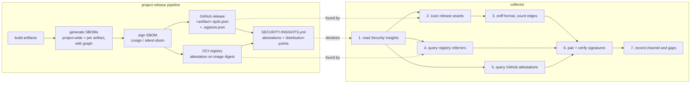

# SBOM publishing recommendations for CNCF projects

**On every tagged release, publish a project-wide SPDX JSON SBOM plus one per shipped artifact, with a dependency graph and a signature, name them so their format is obvious, and say where they are in `SECURITY-INSIGHTS.yml`.**

This is the output the [Supply Chain Security Insights initiative](https://github.com/cncf/toc/issues/1709) said it would produce: "a set of recommendations for consistently publishing and discovering SBOMs for CNCF projects" (TAG-SC, 2026-01-28). It is written for TAG Security & Compliance and project maintainers, as input to the "SBOM and SLSA Build Provenance generation" section of [cncf/toc#2186](https://github.com/cncf/toc/issues/2186).

Alignment: CNCF's own SBOM pipeline, [cncf/sbom](https://github.com/cncf/sbom/blob/e74ea3b262c828a0c26664a3f037dc91b5035010/README.md#best-practice-for-projects-publishing-their-own-sbom), imports a project's release SBOM in preference to its own scan when it meets that pipeline's best-practice rules. These recommendations are written to satisfy those rules; where they add something (per-artifact SBOMs, signing, Security Insights), it is additive, not a substitute.

Data: the collector's 2026-11-26 snapshot of the CNCF landscape (collector PR [#120](https://github.com/halcyondude/supply-chain-security-collector/pull/120), commit [`0078e02`](https://github.com/halcyondude/supply-chain-security-collector/commit/0078e0287b086431843ecbab01d85226dccdb9bc): 266 primary repos, 4,719 releases, 46,197 release assets, published as Parquet in [`site/public/data`](../site/public/data)). **Every number is a lower bound**: we see GitHub release assets and Actions workflow files only, not OCI registries, the GitHub Attestations API, package registries or non-GitHub CI ([known gaps](presentations/2026-04-08-tag-sc/known-gaps-analysis.md)).

## The problem, in data

| what we measured | result |
|---|---|
| repos with any SBOM in a GitHub release | 51 of 266 (19.2%) |
| ...of their last 20 releases, how many carry an SBOM | 680 of 1,000 (68.0%); 19 of 51 repos do it every time |
| distinct SBOM filename suffixes in use | 25, across 51 repos |
| SBOM files whose name does not say SPDX or CycloneDX | 1,796 of 3,254 (55%); 23 repos never say [^basis] |
| format, where the name does say | SPDX in 25 repos, CycloneDX in 5 |
| repos that ship SBOMs only inside a tarball (`sbom.tar.gz`) | 7 |
| SBOM files with their own signature or Sigstore bundle | 553 of 3,254 (17.0%), in 10 repos |
| repos with a `SECURITY-INSIGHTS.yml` | 43 (16.2%); 17 still on schema 1.0.0 |
| ...that declare an SBOM in it | 8; only Jaeger's and Kubewarden's point at a current file |
| repos that publish SBOMs **and** reference an SBOM generator in Actions | 37 (14 publish with no generator visible; 47 reference one and publish nothing, 40 of those Trivy only) |

[^basis]: Counts SBOM documents only, excluding signature, certificate and bundle files. The [State of the Ecosystem report](state-of-the-ecosystem.md) counts every SBOM-flagged asset, including those, and gets 2,176 of 3,910 (56%). Same finding, different basis.

Two things the data cannot show, recorded in the [initiative's final report](https://github.com/cncf/toc/blob/main/tags/tag-security-and-compliance/initiatives/supply-chain-insights/README.md): SBOMs we did find often listed dependencies as a flat list with no tree, and a CNCF-staff effort that rebuilt SBOMs from source got substantially further than one using project-published SBOMs.

## Recommendations

### 1. Attach an SBOM to every release

- **What:** every GitHub release (and every image tag you publish) gets an SBOM, generated by the release pipeline, not by hand.
- **Why:** only 19.2% of repos do it at all, and 32 of the 51 publishers skip it on some releases. A consumer pinned to a release with no SBOM gets nothing.
- **Minimum:** `gh release upload v1.4.0 dist/*.spdx.json`. Missing SBOM fails the release job.

### 2. Put the format in the filename

- **What:** end SPDX files in `.spdx.json` and CycloneDX files in `.cdx.json`. Nothing else in the name needs to be fixed.
- **Why:** 25 suffixes are in use (`.sbom`, `-sbom.spdx`, `.spdx-sbom.json`, `.tar.gz.sbom`...). In 55% of files the format can only be found by downloading and parsing.
- **Minimum:** `kubewarden-1.4.0.spdx.json`, `kubewarden-1.4.0.cdx.json`.

### 3. A project-wide SBOM, plus one per shipped artifact, never archived

- **What:** attach one project-wide SPDX 2.3 JSON document describing the release as a whole (source tree or source tarball), with no OS/arch tokens in its name. In addition, for each binary, archive or image you ship, publish `<artifact-file-name>.spdx.json` next to it. Don't tar SBOMs up.
- **Why:** 31 of 51 publishers already ship more than one SBOM per release; the ones that do it best (e.g. NATS, 14 per release) pair each SBOM with its artifact by name. Seven repos ship SBOMs only as an `sbom.tar.gz`-style archive, which a collector cannot read without downloading and unpacking it, and then cannot tie back to an artifact. cncf/sbom imports only the largest project-wide document per release, tells it apart from per-binary files by the absence of OS/arch tokens, and ignores `sbom.tar.gz`, tag-value `.spdx` and XML ([rules 1, 2, 6](https://github.com/cncf/sbom/blob/e74ea3b262c828a0c26664a3f037dc91b5035010/README.md#best-practice-for-projects-publishing-their-own-sbom)); per-artifact SBOMs alone leave the project being re-scanned.
- **Minimum:** `foo_1.4.0_sbom.spdx.json` (project-wide, as `fluxcd/flux2` does), plus `foo_1.4.0_linux_amd64.tar.gz` → `foo_1.4.0_linux_amd64.tar.gz.spdx.json`. With GoReleaser for the per-artifact files (its default name is `<artifact>.sbom.json`, the most common suffix we saw):

  ```yaml
  sboms:
    - artifacts: archive
      documents: ["{{ .ArtifactName }}.spdx.json"]
  ```

### 4. Ship the dependency graph, not a package list

- **What:** the SBOM records who depends on whom: SPDX `relationships` (`DEPENDS_ON`, `CONTAINS`) or the CycloneDX `dependencies` array.
- **Why:** this was blocking problem 1 in the final report. The initiative's two target questions (CVE impact and dependency "blast radius", [#1873](https://github.com/cncf/toc/issues/1873)) need edges. A flat list answers "is X present", not "what breaks if X changes".
- **Minimum:** generate from the source tree or build (module graph or lock file), not from a scan of the finished binary alone. Include a `DESCRIBES` root (documents without one are dropped by cncf/sbom), `licenseDeclared` as well as `licenseConcluded`, per-package checksums, and build/test dependencies typed as `BUILD_DEPENDENCY_OF` / `TEST_DEPENDENCY_OF` rather than dropped ([rules 3, 5](https://github.com/cncf/sbom/blob/e74ea3b262c828a0c26664a3f037dc91b5035010/README.md#best-practice-for-projects-publishing-their-own-sbom)). Check in CI that the file has edges beyond the root:

  ```bash
  jq '[.relationships[] | select(.relationshipType=="DEPENDS_ON")] | length' foo.spdx.json   # > 0
  ```

### 5. Sign the SBOM, not just the binaries

- **What:** each SBOM file gets its own Sigstore signature, or is published as an attestation about the artifact it describes.
- **Why:** 38 repos sign something in their releases, but only 10 sign their SBOMs (17.0% of SBOM files). Signing and SBOMs grew up as separate pipelines ([findings, §2](presentations/2026-04-08-tag-sc/cncf-supply-chain-findings.md)). An unsigned SBOM is a claim with no author.
- **Minimum**, either:

  ```bash
  cosign sign-blob --bundle foo.spdx.json.sigstore.json foo.spdx.json   # keyless, sibling file
  ```

  or the `actions/attest-sbom` action in GitHub Actions, verified with `gh attestation verify <artifact> -R <owner>/<repo>`. Keep the signature next to the SBOM with the same name plus a suffix.

### 6. Declare where SBOMs live in `SECURITY-INSIGHTS.yml`

- **What:** list each SBOM channel in the [OpenSSF Security Insights](https://github.com/ossf/security-insights) file, with a URL a tool can fetch.
- **Why:** this is the only place a collector can learn about channels it would otherwise miss. Today 43 repos have the file, 25 of the 51 SBOM publishers among them, but only 8 repos declare an SBOM. Of those, only Jaeger and Kubewarden point at a file in the current release; the rest point at a releases page (Argo CD, Karmada, Volcano, k8gb), a docs page (Cilium) or a registry page (metal3).
- **Minimum** (schema 2.x; `compliance-trestle` uses this path, metal3 the same `predicate-uri`):

  ```yaml
  repository:
    release:
      attestations:
        - name: SBOM (SPDX)
          location: https://github.com/<org>/<repo>/releases/latest/download/<project>.spdx.json
          predicate-uri: https://spdx.dev/Document
          comment: One SPDX SBOM per release archive, named <archive>.spdx.json.
  ```

  Projects still on 1.0.0 can use `dependencies.sbom[].sbom-file` with the same URL until they migrate.

### 7. For images, attach the SBOM to the image and say so

- **What:** in addition to the GitHub release assets (recommendation 3), attach the image SBOM to the image digest in the registry, and list the registry under `repository.release.distribution-points` in Security Insights.
- **Why:** the largest projects publish this way (Kubernetes at `sbom.k8s.io` and `registry.k8s.io`, metal3 on quay.io) and are invisible to a GitHub-only collector ([known gaps](presentations/2026-04-08-tag-sc/known-gaps-analysis.md)). Without the declaration, a collector has to guess registries. A registry-only SBOM is not enough: cncf/sbom reads `releases/tags/<tag>` only ([rule 7](https://github.com/cncf/sbom/blob/e74ea3b262c828a0c26664a3f037dc91b5035010/README.md#best-practice-for-projects-publishing-their-own-sbom)).
- **Minimum:** `cosign attest --type spdxjson --predicate img.spdx.json <image>@sha256:<digest>`; consumers find it with `cosign tree` or `oras discover`.

## Discovery contract

What a collector should do, in order, and what a project can rely on being found if it follows the recommendations above.

1. **Read Security Insights.** Look for `SECURITY-INSIGHTS.yml` in the repo root, then `.github/`, matching case-insensitively (both spellings occur). Take SBOM entries from `repository.release.attestations[]` whose `predicate-uri` is `https://spdx.dev/Document` or `https://cyclonedx.org/bom` (2.x), or `dependencies.sbom[].sbom-file` (1.0.0). Note `distribution-points` for step 4.
2. **Scan release assets** of the latest release, then older ones. Match `\.(spdx|cdx)\.json$` first; fall back to cncf/sbom's rule, a name containing `spdx`, `cdx`, `cyclonedx` or `bom` and ending in `.json`, so both pipelines see the same files. Treat a name with no OS/arch token as the project-wide document.
3. **Sniff, don't trust names.** Fetch the first bytes: SPDX JSON has `spdxVersion`, CycloneDX JSON has `"bomFormat": "CycloneDX"`. Record format, spec version, package count and edge count (recommendation 4).
4. **Ask the registry** for each image in `distribution-points`: OCI referrers or cosign attestations on the digest.
5. **Ask GitHub** for artifact attestations on the release artifacts.
6. **Pair signatures** by name: `<sbom>.sig`, `.pem`, `.asc`, `.sigstore.json`, `.bundle`. Verify where possible; record "present" vs "verified" separately.
7. **Record the channel** each SBOM came from, and record misses as "not found in channels X, Y", never as "does not publish". Do not infer SBOMs from CI tool references: a generator in a workflow says nothing about whether, or where, its output is published. In our data 7 repos run Syft in Actions and attach no SBOM to their releases.



## Appendix: SQL for every figure

DuckDB over the published Parquet. Setup, then one view used by most queries:

```sql
-- for each table t: CREATE VIEW t AS SELECT * FROM read_parquet('site/public/data/t.parquet');

-- SBOM-flagged assets (01_artifact_analysis.sql) split into documents, archives and signatures
CREATE TEMP VIEW sbom_assets AS
SELECT nameWithOwner, release_id, asset_name, lower(asset_name) AS n,
  CASE WHEN regexp_matches(lower(asset_name), '\.(sig|asc|pem|crt|cert|bundle|sigstore|sigstore\.json|intoto\.jsonl|att)$') THEN 'companion'
       WHEN regexp_matches(lower(asset_name), '\.(tar\.gz|tgz|zip)$') THEN 'archive'
       ELSE 'document' END AS kind,
  CASE WHEN lower(asset_name) LIKE '%spdx%' THEN 'spdx'
       WHEN regexp_matches(lower(asset_name), 'cyclonedx|cdx') THEN 'cyclonedx'
       ELSE 'not in name' END AS fmt
FROM agg_artifact_patterns WHERE is_sbom;
```

```sql
-- repos (266), with SBOMs (51), with signatures (38)
SELECT count(*), sum(has_sbom_artifact::int), sum(has_signature_artifact::int) FROM agg_repo_summary;

-- format named in file, by repo: spdx 25, cyclonedx 5
SELECT fmt, count(DISTINCT nameWithOwner) FROM sbom_assets WHERE kind <> 'companion' GROUP BY 1;

-- release coverage among publishers: 680 / 1,000, 19 every release
SELECT sum(releases_with_sbom_count), sum(total_releases),
       count(*) FILTER (releases_with_sbom_count = total_releases)
FROM agg_repo_summary WHERE has_sbom_artifact;

-- 25 distinct suffixes
SELECT count(DISTINCT regexp_extract(n, '((?:[._-]?(?:sbom|spdx|cyclonedx|cdx|json|tar|gz))+)$', 1))
FROM sbom_assets WHERE kind <> 'companion';

-- format not in name: 1,796 of 3,254 files; 23 repos never name it
SELECT count(*) FILTER (fmt = 'not in name'), count(*) FROM sbom_assets WHERE kind <> 'companion';
SELECT count(*) FROM (SELECT nameWithOwner FROM sbom_assets WHERE kind <> 'companion'
                      GROUP BY 1 HAVING bool_and(fmt = 'not in name'));

-- archive-only publishers: 7
SELECT nameWithOwner FROM sbom_assets GROUP BY 1
HAVING count(*) FILTER (kind = 'document') = 0 AND count(*) FILTER (kind = 'archive') > 0;

-- more than one SBOM per release: 31 of 51
SELECT count(*) FILTER (per_rel > 1.5) FROM (
  SELECT nameWithOwner, count(*) * 1.0 / count(DISTINCT release_id) AS per_rel
  FROM sbom_assets WHERE kind <> 'companion' GROUP BY 1);

-- SBOM files with a sibling signature: 553 of 3,254, 10 repos
WITH docs AS (SELECT * FROM sbom_assets WHERE kind <> 'companion'),
sig AS (SELECT release_id, lower(name) AS n FROM base_release_assets
        WHERE regexp_matches(lower(name), '\.(sig|asc|pem|bundle|sigstore|sigstore\.json|intoto\.jsonl)$'))
SELECT count(*) FILTER (s), count(*), count(DISTINCT nameWithOwner) FILTER (s) FROM (
  SELECT nameWithOwner, EXISTS (SELECT 1 FROM sig WHERE sig.release_id = docs.release_id
                                AND starts_with(sig.n, docs.n || '.')) AS s FROM docs);

-- Security Insights: 43 repos; 17 on 1.0.0; 25 of 51 publishers have one
SELECT schema_version, count(*) FROM base_si_documents GROUP BY 1;
SELECT count(*) FROM (SELECT DISTINCT nameWithOwner FROM sbom_assets WHERE kind <> 'companion') p
JOIN base_repositories r USING (nameWithOwner) WHERE r.id IN (SELECT repo_id FROM base_si_documents);

-- SBOMs declared in Security Insights: 6 (1.0.0) + 2 (2.x: metal3, k8gb); inspect URLs by hand
SELECT r.nameWithOwner, s.sbom_file, s.sbom_url FROM base_si_sboms s JOIN base_repositories r ON r.id = s.repo_id;
SELECT r.nameWithOwner, a.attestation_predicate_uri, a.attestation_location FROM agg_si_attestations a
JOIN base_repositories r ON r.id = a.repo_id WHERE regexp_matches(lower(a.attestation_predicate_uri), 'spdx|cyclonedx');

-- is the declared file in the repo's latest release? jaeger (v2.23.0) and kubewarden/adm-controller (v1.39.0) only
WITH latest AS (SELECT repository_id, id FROM base_releases
                QUALIFY row_number() OVER (PARTITION BY repository_id ORDER BY createdAt DESC) = 1)
SELECT s.sbom_file, count(a.id) FROM base_si_sboms s
LEFT JOIN latest l ON l.repository_id = s.repo_id
LEFT JOIN base_release_assets a ON a.release_id = l.id AND a.name = regexp_extract(s.sbom_file, '[^/]+$')
GROUP BY 1;

-- generator in Actions vs SBOM in releases: (true,true)=37, (false,true)=14, (true,false)=47
SELECT uses_sbom_generator, has_sbom_artifact, count(*) FROM agg_repo_summary GROUP BY ALL;

-- of the 47, Trivy only: 40; Syft, no release SBOM: 7
WITH g AS (SELECT nameWithOwner, bool_and(tool_name = 'trivy') AS trivy_only, bool_or(tool_name = 'syft') AS syft
           FROM agg_workflow_tools WHERE tool_category = 'sbom-generator' GROUP BY 1)
SELECT count(*) FILTER (trivy_only), count(*) FILTER (syft) FROM g JOIN agg_repo_summary r USING (nameWithOwner)
WHERE NOT r.has_sbom_artifact;

```

Caveats: `is_sbom` is filename full-text match (`sbom OR spdx OR cyclonedx`), so SBOMs named without those words are missed and the counts are a floor. Kyverno's `*-bom.cdx.json` and Inspektor Gadget's `*.bom.json` are two such misses. CI-tool flags (`uses_*`) come from workflow file contents (this collection used the fix in [#118](https://github.com/halcyondude/supply-chain-security-collector/pull/118); earlier snapshots matched file names only). `uses_sbom_generator` includes Trivy, which is also used purely as a scanner, and misses `anchore/sbom-action`, which runs Syft without naming it. SBOM content (graph shape, quality) was not collected; recommendation 4 rests on the final report, not this data.
