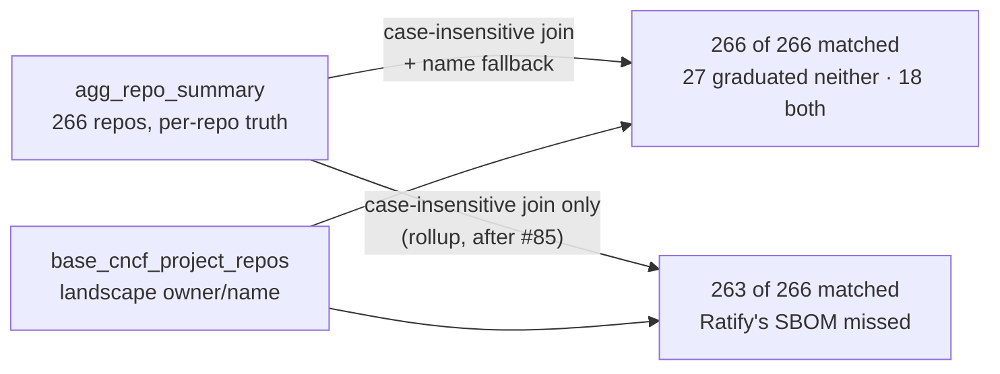
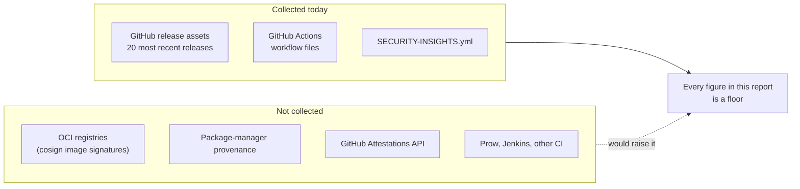

# State of the Ecosystem — CNCF Supply Chain Security Insights

## Changelog

| Version | Date | Summary |
|---------|------|---------|
| 1.0 | 2026-07-16 | Initial report. Baseline scan of all 236 CNCF projects; SBOM prevalence, format split, per-maturity table. |
| 1.1 | 2026-11-26 | Review fixes. All figures re-verified against the committed Parquet; corrected the "unknown format" share; reconciled 13 vs 14 and the April deck's maturity denominators; added status note and diagrams; fixed data path and links. Withdrew CI-tool figures (workflow index bug). |
| 1.2 | 2026-11-26 | Every figure re-derived from the 2026-11-26 snapshot (collector [#120](https://github.com/halcyondude/supply-chain-security-collector/pull/120)): 266 projects, fixed project join and workflow index. Tooling section and its SQL restored. Rollup note rewritten now that the casing bug is fixed; 13-vs-14 footnote dropped. |

---

*Deliverable for [cncf/toc#1874](https://github.com/cncf/toc/issues/1874) — "SCI: Assess the State of CNCF Project Artifacts" — under initiative [cncf/toc#1709](https://github.com/cncf/toc/issues/1709), TAG Security & Compliance. Led by Matt Young ([@halcyondude](https://github.com/halcyondude)); TAG-SC liaison Evan Anderson ([@evankanderson](https://github.com/evankanderson)). Board: [cncf/projects/80](https://github.com/orgs/cncf/projects/80/views/4).*

> **Status (November 2026).** [#1874](https://github.com/cncf/toc/issues/1874) and [#1879](https://github.com/cncf/toc/issues/1879) closed on 2026-10-08. The initiative ([#1709](https://github.com/cncf/toc/issues/1709)) closed on 2026-11-04 with a final summary in [cncf/toc#2320](https://github.com/cncf/toc/pull/2320), which records the blocking problems found. The data and findings below stand. §6 and §7 are the next steps as proposed in July 2026, kept for the record.

> **Data.** Every figure is from the 2026-11-26 snapshot: collector PR [#120](https://github.com/halcyondude/supply-chain-security-collector/pull/120), commit [`0078e02`](https://github.com/halcyondude/supply-chain-security-collector/commit/0078e0287b086431843ecbab01d85226dccdb9bc), `site/public/data/*.parquet`. 266 CNCF projects, one primary repo each, all 266 collected.

---

## 1. The mandate

We chartered Supply Chain Security Insights (SCI) to answer a question the CNCF has never been able to answer with data: **what is the collective supply chain posture of the CNCF ecosystem?** SBOMs, signatures, attestations, VEX — the metadata exists, but it's scattered across 266 projects, dozens of release conventions, and half a dozen publishing channels. Nobody has a unified, queryable view. You can't reason about ecosystem risk you can't measure.

The charter ([#1709](https://github.com/cncf/toc/issues/1709)) is explicit about scope. **In scope:** collecting supply chain metadata, normalizing it, standing up a queryable store (GUAC is the reference target), and producing example analyses across the ecosystem. **Out of scope, and staying out of scope:** real-time alerting, policy enforcement, and analysis beyond CNCF projects. This is an **insight and measurement** effort. It is not a gate, a scoreboard, or a compliance cop.

Milestone 1 sets the near-term bar: a CNCF community member should be able to stand up GUAC on a single-node cluster (kind) and answer two concrete questions:

1. What projects would be impacted if a library changed to an incompatible, non-OSI license — the "rug pull"?
2. What projects would be impacted by a CVE discovered in a given library?

This report is the deliverable that precedes that graph work. Before you can answer "who's impacted by a bad dependency," you have to know **what metadata even exists to build the graph from.** That's what we measured.

## 2. What "done" looks like for this deliverable

[#1874](https://github.com/cncf/toc/issues/1874) asks for a report on three things across CNCF projects:

- **Prevalence** — how many projects publish SBOMs?
- **Formats** — SPDX or CycloneDX?
- **Findability** — where do the artifacts live, and can a tool reliably discover them?

The pilot goal was 10–15 projects. We did all 266.

## 3. What shipped — the collector

We built the [Supply Chain Security Collector](https://github.com/halcyondude/supply-chain-security-collector) and ran it against the **entire CNCF landscape — all 266 projects, every maturity level.** That's an order of magnitude past the pilot target.

The scan covered:

| Measured | Count |
|----------|-------|
| CNCF projects (primary repos) | 266 |
| Releases inspected | 4,719 |
| Release assets classified | 46,197 |
| CI workflow files parsed | 4,045 |

The tool collects from the GitHub GraphQL API: release assets (SBOMs, `.sig` files, attestations, cosign bundles), GitHub Actions workflow files (tool references via full-text search; see the caveats under Tooling signal), branch protection rules, and `SECURITY-INSIGHTS.yml`. Branch protection needs a personal access token; this run used `GITHUB_TOKEN`, so the snapshot has no branch-protection rows and no figure here uses them. Per repo it emits a normalized set of booleans — does this project publish an SBOM, sign releases, attach attestations, and which tools does its CI reference — plus per-project and per-maturity rollups. Output is DuckDB + Parquet, so anyone can re-run the numbers in this report with a single SQL query. There's also a [live in-browser explorer](https://halcyondude.github.io/supply-chain-security-collector/) (DuckDB-WASM, no backend) if you'd rather click than write SQL.

## 4. What we found — the baseline

Read this section as a **starting line, not a scoreboard.** Before this scan, the ecosystem-wide numbers didn't exist. Now they do. That's the win. The gaps below are things we can now *see* and therefore *close* — they were always there; they were just invisible.

### The headline

**27 of the 41 CNCF graduated projects publish neither an SBOM nor a signature in their release assets.**

These are the projects that carry the most weight in the ecosystem — Kubernetes, containerd, etcd, Prometheus, Cilium, Harbor, cert-manager, Linkerd, and 19 others (full list in the appendix). Graduated projects are the ones downstream users lean on most. When the most-depended-on tier is also the tier with the least machine-readable provenance in release assets, that's not a per-project failing — it's **systemic-gap evidence.** The signal is about the ecosystem's defaults and tooling, not about any one project's diligence.

> A hard caveat, stated up front: **every number here is a lower bound.** The collector sees GitHub release assets and CI workflows. It does *not* see container image signatures in OCI registries (`cosign verify`), npm/PyPI provenance, GitHub's Attestations API, or non-GitHub CI (Prow, Jenkins, etc.). Many of the 27 almost certainly sign their container images — they just don't attach `.sig` files to GitHub releases. Nine of them reference cosign or Sigstore in their workflows (see Tooling signal). **Absence of evidence here is not evidence of absence.** See §5.

### Prevalence, by maturity

Per-maturity view across all 266 projects (release-asset evidence, lower bounds):

| Maturity | Projects | Publish SBOM | SBOM % | Publish signature | Sig % | Both | Neither |
|----------|----------|--------------|--------|-------------------|-------|------|---------|
| Graduated | 41 | 7 | 17.1% | 9 | 22.0% | 2 | **27** |
| Incubating | 38 | 14 | 36.8% | 13 | 34.2% | 10 | 21 |
| Sandbox | 160 | 27 | 16.9% | 14 | 8.8% | 6 | 125 |
| Archived | 27 | 3 | 11.1% | 2 | 7.4% | 0 | 22 |
| **All** | **266** | **51** | **19.2%** | **38** | **14.3%** | **18** | **195** |

The April 2026 [findings report](presentations/2026-04-08-tag-sc/cncf-supply-chain-findings.md) showed 33 / 36 / 135 / 23 projects per tier. It used an earlier snapshot of a smaller landscape and a case-sensitive join that matched 227 of 236 repos, so its tier counts are not comparable with this table.

The counterintuitive result: **incubating projects out-publish graduated ones** on both SBOMs and signatures. That fits a story where SBOM/signing tooling matured *after* the graduated cohort locked in their release pipelines — the newer projects adopted it as a default, the established ones haven't retrofitted.

**Only 18 of 266 projects do both** — publish an SBOM *and* sign releases. That's the number that matters if the goal is verifiable provenance, and it's thin across every tier.

### Formats — SPDX wins decisively

All 3,910 SBOM artifacts found in release assets, by format (a repo can appear in more than one row):

| Format | SBOM artifacts | Distinct repos |
|--------|----------------|----------------|
| SPDX | 1,660 | 25 |
| CycloneDX | 74 | 5 |
| Unknown / unclassified | 2,176 | 26 |

Among classified SBOMs, **SPDX outnumbers CycloneDX ~22:1 by artifact count** (1,660 vs 74). That ratio is artifact-skewed — a few SPDX-heavy projects attach many SBOMs per release — so read it alongside the **per-repo** count: **25 repos publish SPDX, 5 publish CycloneDX** (5:1 by project). Either way, SPDX is the de facto ecosystem default; CycloneDX presence is real but small. The large "unknown" bucket is itself a **findability** finding: more than half of SBOM-like artifacts (2,176 of 3,910, 56%) don't announce their format in a way a scanner can cheaply detect — which means any downstream aggregator (including GUAC) has to open and sniff files rather than trust naming conventions.

### Tooling signal

What GitHub Actions workflow files mention, across the 266 primary repos (workflow content, so a floor; 201 repos mention at least one tracked tool):

| Tool | Repos (workflow-declared) |
|------|---------------------------|
| CodeQL | 152 |
| Dependabot | 74 |
| cosign | 67 |
| GoReleaser | 61 |
| Trivy | 60 |
| Syft | 37 |
| Renovate | 29 |

v1.1 withdrew this table: the workflow index was rebuilt on file names, so detection matched names, not contents ([#118](https://github.com/halcyondude/supply-chain-security-collector/pull/118)). These figures come from the fixed collection.

Read them as mentions, not adoption. A workflow that skips `dependabot[bot]` PRs mentions Dependabot without running it, and Trivy is often a scanner rather than an SBOM generator. Syft is undercounted: `anchore/sbom-action` runs Syft without naming it.

Two things to note. First, **code scanning (CodeQL, 152) is still far more common than supply-chain artifact tooling** — the ecosystem is better at scanning its own source than at emitting verifiable build outputs. Second, **signing in CI is much more common than signatures in releases.** 71 repos reference cosign or Sigstore in a workflow; 38 attach signatures to releases; only 19 do both. The other 52 probably sign images or other artifacts outside the GitHub release, which the collector doesn't see. Nine of the 27 graduated "neither" projects are among them: Cilium, CRI-O, Falco, Harbor, KEDA, Kyverno, Linkerd, Rook and SPIRE.

### A data-correction note, in the open

Earlier versions of this report found a case-sensitivity bug in the collector's project-level rollup (`agg_cncf_project_summary`): it counted CubeFS as unsigned ([#78](https://github.com/halcyondude/supply-chain-security-collector/issues/78)). This snapshot was built with the fix ([#85](https://github.com/halcyondude/supply-chain-security-collector/pull/85)), and CubeFS now shows its 14 signature artifacts in both layers. The rollup and the per-repo table agree on the headline: 27 graduated projects with neither.

One gap remains. Three repos were scanned under a renamed owner org (Ratify, composefs, OpenMetrics), and the rollup can't match them to their landscape entry. Ratify ships an SBOM, so the rollup reports 26 sandbox SBOM publishers where the per-repo table has 27. We derived every number in this report from the per-repo layer, which falls back to matching on repo name. We're flagging this because if we're asking projects to trust our numbers, we owe them the bugs we found in our own.



## 5. Methodology and reproducibility

The whole point is that you can check our work.

- **Open source, MIT.** The collector is on GitHub. Clone it, point it at any repo set, get a DuckDB database back.
- **Runs from a clone.** `npm install`, set a GitHub token, `npm test` runs three projects; `npm start` runs the full landscape.
- **Every number in this report is one SQL query.** The committed Parquet lives at `site/public/data/*.parquet` (the same files the explorer loads). This version's figures are from the #120 snapshot; the explorer shows it once #120 merges. The exact queries that produced these figures are in the appendix.
- **In-browser explorer.** [halcyondude.github.io/supply-chain-security-collector](https://halcyondude.github.io/supply-chain-security-collector/) runs DuckDB-WASM client-side — no backend, no signup, write your own SQL against the same data.

### Known limits — read before quoting a number

The collector sees **release assets and CI workflow files on GitHub.**



It does not see:

- **OCI registries** — container image signatures via cosign keyless (the big one for the graduated tier)
- **Package-manager provenance** — npm provenance, PyPI attestations, Go module checksums
- **GitHub Attestations API** — `actions/attest-build-provenance` (not yet queried)
- **Non-GitHub CI** — Prow (Kubernetes uses it heavily), Azure Pipelines, Jenkins, CircleCI
- **Config-driven signing** — GoReleaser signing that doesn't surface as a literal tool reference

SBOMs are found by file name (`sbom`, `spdx` or `cyclonedx`), so files named otherwise are missed, such as Kyverno's `*-bom.cdx.json` and Inspektor Gadget's `*.bom.json`. Scan depth is capped at the 20 most recent releases per repo. **Every figure is a floor, not a ceiling.** A project reading "neither" here may be signing everything through a channel we don't yet collect. This is exactly why §7's ask includes a correction loop *before* any project-level publication.

## 6. What remains

This report is the map. Here's the road.

- **Milestone 1 — the GUAC graph.** Stand up GUAC on kind, ingest SBOMs, and answer the two charter questions: license "rug-pull" impact and CVE impact across dependency trees. The baseline in §4 tells us which projects already emit graph-ingestible metadata (18 do both today) and where we'll need to fetch from OCI/package registries to fill gaps.
- **Graph federation — [#1879](https://github.com/cncf/toc/issues/1879).** The reference architecture for creating, enriching, aggregating, and federating supply chain graphs. This is where per-project graphs compose into an ecosystem view.
- **Close the collector's blind spots.** Add OCI registry inspection and the GitHub Attestations API so the numbers move from "lower bound" toward "actual." That single change will materially revise the graduated-tier picture.

The CNCF landscape graph has the same question on file: [cncf/landscape-graph#15](https://github.com/cncf/landscape-graph/issues/15) asks for package dependency trees overlaid with CVE announcements. **That is where Milestone 1 is headed.** SCI and the landscape graph converge on the same target from two directions.

## 7. The ask

To the TOC and TAG Security & Compliance:

1. **Advance SCI to its next phase** — greenlight the Milestone 1 GUAC work and the [#1879](https://github.com/cncf/toc/issues/1879) federation reference architecture on the strength of this baseline.
2. **Begin the hand toward TAG stewardship.** SCI has proven it can measure the ecosystem end to end. The natural long-term home for a repeatable measurement capability is inside a TAG, as durable community infrastructure.
3. **Hold the line on scope.** This stays **insight and measurement** — never alerting, never enforcement. The value is a shared, honest picture the community can act on, not a gate the community has to satisfy.

**On the guardrails — this matters as much as the numbers.** This is complementary to [CLOMonitor](https://clomonitor.io/) and the [CNCF landscape](https://landscape.cncf.io/), not a competitor. CLOMonitor scores best practices; the landscape maps the ecosystem; SCI measures supply chain artifact reality and feeds the graph. We are **not** shaming projects. Every project-level finding gets a **correction loop before any project-facing publication** — projects can supply the OCI/registry evidence our GitHub-only scan can't see, and we'll incorporate it. The 27 are named here as **evidence of a systemic tooling-and-defaults gap**, not as a ranking. If we've undercounted you — and for several of the 27, we almost certainly have — the appendix tells you exactly how to correct the record.

---

## Appendix A — The 27 graduated projects (correction path)

All 41 graduated projects were scanned; these 27 show neither an SBOM nor a signature **in GitHub release assets** (a lower bound — see §5). If your project signs images in an OCI registry, publishes provenance via a package manager, or uses the GitHub Attestations API, that evidence is not visible to the current collector.

**To correct the record:** open an issue on [the collector](https://github.com/halcyondude/supply-chain-security-collector/issues) pointing at the channel where your artifacts live (registry, package index, attestations API). We'll extend the collector to read that channel and re-run; nothing is needed on your end.

| Project | Repo |
|---------|------|
| Buildpacks | https://github.com/buildpacks/pack |
| CRI-O | https://github.com/cri-o/cri-o |
| Cilium | https://github.com/cilium/cilium |
| CloudEvents | https://github.com/cloudevents/spec |
| CoreDNS | https://github.com/coredns/coredns |
| Crossplane | https://github.com/crossplane/crossplane |
| Dapr | https://github.com/dapr/dapr |
| Falco | https://github.com/falcosecurity/falco |
| Fluentd | https://github.com/fluent/fluentd |
| Harbor | https://github.com/goharbor/harbor |
| KEDA | https://github.com/kedacore/keda |
| KubeEdge | https://github.com/kubeedge/kubeedge |
| Kubeflow | https://github.com/kubeflow/kubeflow |
| Kubernetes | https://github.com/kubernetes/kubernetes |
| Kyverno | https://github.com/kyverno/kyverno |
| Linkerd | https://github.com/linkerd/linkerd2 |
| Open Policy Agent (OPA) | https://github.com/open-policy-agent/opa |
| OpenTelemetry | https://github.com/open-telemetry/community |
| Prometheus | https://github.com/prometheus/prometheus |
| Rook | https://github.com/rook/rook |
| SPIFFE | https://github.com/spiffe/spiffe |
| SPIRE | https://github.com/spiffe/spire |
| TiKV | https://github.com/tikv/tikv |
| Vitess | https://github.com/vitessio/vitess |
| cert-manager | https://github.com/cert-manager/cert-manager |
| containerd | https://github.com/containerd/containerd |
| etcd | https://github.com/etcd-io/etcd |

> Known undercounts. **Kyverno** attaches CycloneDX SBOMs (`*-bom.cdx.json`) to its releases, but the names lack `sbom`, `spdx` or `cyclonedx`, so the collector misses them; on a manual read it isn't "neither". **OpenTelemetry** and **SPIFFE** are scanned at the repo the landscape lists (`open-telemetry/community`, `spiffe/spiffe`), which has no GitHub releases.

## Appendix B — Reproduce every number

Run from `site/public/data/` with the DuckDB CLI (`duckdb` then paste), or in the [explorer](https://halcyondude.github.io/supply-chain-security-collector/). Data: the 2026-11-26 snapshot (#120, commit `0078e02`). Verified with DuckDB 2.0.1. The repo→maturity join is case-insensitive with a name-only fallback (3 CNCF projects were scanned under a renamed owner org). It reads `agg_repo_summary`, not the project rollup, because the rollup can't match those 3.

```sql
-- Base table: join per-repo summary to project maturity (all 266 matched)
CREATE TABLE rm AS
WITH repo_maturity AS (
  SELECT rs.*, COALESCE(pr1.project_name, pr2.project_name) AS project_name
  FROM 'agg_repo_summary.parquet' rs
  LEFT JOIN 'base_cncf_project_repos.parquet' pr1
    ON lower(rs.owner)=lower(pr1.owner) AND lower(rs.repo)=lower(pr1.name)
  LEFT JOIN 'base_cncf_project_repos.parquet' pr2
    ON lower(rs.repo)=lower(pr2.name) AND pr1.project_name IS NULL AND pr2."primary"
)
SELECT r.*, p.maturity, p.display_name AS proj_display
FROM repo_maturity r
JOIN 'base_cncf_projects.parquet' p ON r.project_name = p.project_name;

-- Headline: 27 graduated projects with neither SBOM nor signature
SELECT COUNT(*) FROM rm
WHERE maturity='graduated' AND NOT has_sbom_artifact AND NOT has_signature_artifact;   -- 27

-- Only 18 of 266 do both
SELECT COUNT(*) FROM rm WHERE has_sbom_artifact AND has_signature_artifact;             -- 18

-- Per-maturity prevalence table
SELECT maturity, COUNT(*) AS projects,
  SUM(has_sbom_artifact::int) AS with_sbom,
  SUM(has_signature_artifact::int) AS with_sig,
  SUM((has_sbom_artifact AND has_signature_artifact)::int) AS both,
  SUM((NOT has_sbom_artifact AND NOT has_signature_artifact)::int) AS neither
FROM rm GROUP BY ROLLUP (maturity) ORDER BY maturity;   -- NULL row = All
-- archived 27/3/2/0/22, graduated 41/7/9/2/27, incubating 38/14/13/10/21,
-- sandbox 160/27/14/6/125, All 266/51/38/18/195

-- SPDX vs CycloneDX split (by artifact and by repo)
SELECT sbom_format, COUNT(*) AS artifacts, COUNT(DISTINCT nameWithOwner) AS repos
FROM 'agg_artifact_patterns.parquet' WHERE is_sbom GROUP BY sbom_format;
-- unknown 2176 / 26, spdx 1660 / 25, cyclonedx 74 / 5  (3,910 artifacts total)

-- Scan scale
SELECT
  (SELECT COUNT(*) FROM 'base_releases.parquet') AS releases,          -- 4719
  (SELECT COUNT(*) FROM 'base_release_assets.parquet') AS assets,      -- 46197
  (SELECT COUNT(*) FROM 'base_workflows.parquet') AS workflows;        -- 4045

-- Tool adoption (workflow-declared)
SELECT SUM(uses_codeql::int) AS codeql, SUM(uses_goreleaser::int) AS goreleaser,
  SUM(uses_trivy::int) AS trivy, SUM(uses_dependabot::int) AS dependabot,
  SUM(uses_renovate::int) AS renovate, SUM(uses_syft::int) AS syft,
  SUM(uses_cosign::int) AS cosign
FROM 'agg_repo_summary.parquet';
-- codeql 152, goreleaser 61, trivy 60, dependabot 74, renovate 29, syft 37, cosign 67

-- Repos mentioning any tracked tool
SELECT COUNT(DISTINCT nameWithOwner) FROM 'agg_workflow_tools.parquet';             -- 201

-- Signing in CI vs signatures in releases
SELECT (uses_cosign OR uses_sigstore) AS ci_signing, has_signature_artifact, COUNT(*)
FROM rm GROUP BY ALL ORDER BY ALL;
-- (false,true) 19, (true,false) 52, (true,true) 19: 71 in CI, 38 in releases

-- Graduated "neither" projects that reference cosign or Sigstore in CI
SELECT COUNT(*), string_agg(proj_display, ', ' ORDER BY lower(proj_display)) FROM rm
WHERE maturity='graduated' AND NOT has_sbom_artifact AND NOT has_signature_artifact
  AND (uses_cosign OR uses_sigstore);                                                   -- 9

-- The rollup after #85: agrees on the headline, misses Ratify (renamed owner)
SELECT COUNT(*) FROM 'agg_cncf_project_summary.parquet'
WHERE maturity='graduated' AND repos_with_sbom=0 AND repos_with_signatures=0;   -- 27
SELECT COUNT(*) FROM 'agg_cncf_project_summary.parquet'
WHERE maturity='sandbox' AND repos_with_sbom>0;                                 -- 26 (per-repo: 27)
```
