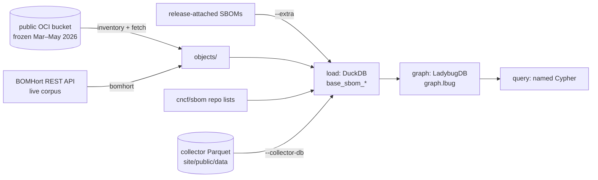

# sbom_corpus: the cncf/sbom corpus in DuckDB and LadybugDB

Prototype for the [cncf/sbom pivot](../docs/background/cncf-sbom-pivot.md). It reads CNCF's own
from-source SBOMs ([cncf/sbom](https://github.com/cncf/sbom), served by [BOMHort](https://bomhort.cncf.io)),
normalizes them into DuckDB `base_sbom_*` tables, and builds a LadybugDB property graph with the
collector's release-asset and CI-tool signals as overlays.



## Run

```bash
uv sync                                    # or: pip install duckdb httpx pydantic pyyaml real-ladybug opentelemetry-sdk
python -m sbom_corpus inventory            # list both public buckets -> inventory.parquet (11k objects)
python -m sbom_corpus fetch                # newest SBOM per project from the public bucket (~0.7 GB)
python -m sbom_corpus bomhort              # newest SBOM per project from BOMHort (~0.6 GB, polite rate)
python -m sbom_corpus load --collector-db site/public/data   # DuckDB, ~2 min for ~460 SBOMs
python -m sbom_corpus graph                # LadybugDB, seconds
python -m sbom_corpus query list
python -m sbom_corpus query blast-radius --param package=pkg:golang/golang.org/x/net
```

Everything lands in `output/sbom-corpus/` (git-ignored). `--help` on every command lists its options.

## Design notes

- **Bounded memory.** Documents are read in batches of 25 with `read_json_objects`; DuckDB spills to
  `output/sbom-corpus/duckdb-tmp`. Downloads stream to disk. Corpus size only changes run time.
- **Generator-agnostic.** The loader handles every generator in the corpus (Waybill, mikebom,
  `sigs.k8s.io/bom`, syft and trivy imports). Owner/repo and tag come from the post-processed root purl
  when present, and fall back to older fields, then to the bucket key plus cncf/sbom's repo lists.
- **Identity.** `Release = owner/repo@version` (leading `v` dropped, so bucket folders join GitHub tags).
  `Package = purl without version`. `PackageVersion` is shared across releases, except unresolved
  versions (`v0.0.0-unknown`, `NOASSERTION`), which stay local to their release so they cannot bridge
  unrelated SBOMs.
- **Edges stay in their SBOM.** `DEPENDS_ON` carries the release that asserts it, and traversals filter on
  it, so a path never mixes two SBOMs. `INCLUDES` (release to package) answers presence questions even
  for flat SBOMs. `DEPENDS_ON_REPO` rolls everything up to a small repo-to-repo graph for views.
- **HTTP.** One `httpx` transport adds rate limiting, jittered retries and OpenTelemetry spans.
  BOMHort is a shared production service: the client stays at 4 requests/s.
- **Telemetry.** OpenTelemetry traces and metrics; OTLP when `OTEL_EXPORTER_OTLP_ENDPOINT` is set,
  console with `--verbose`.

## Tables

| DuckDB table | Grain |
|---|---|
| `base_sbom_documents` | one SBOM document (bucket key, generator, root purl, owner/repo, tag, quality annotations) |
| `base_sbom_packages` | one package in one document (purl, package key, licenses, checksum, scope, source repo) |
| `base_sbom_relationships` | one SPDX relationship, as written |
| `base_sbom_dependencies` | dependency relationships normalized to dependent to dependency, with scope |
| `base_sbom_annotations` | document and package annotations, with Waybill `field`/`value` parsed |
| `base_sbom_releases` | the preferred SBOM per `owner/repo@version` |
| `ref_sbom_repos` | cncf/sbom's `cncf-projects.yaml`, `repositories.yaml`, `discovered-repos.yaml` |
| `collector_*` | collector overlay tables, copied in when `--collector-db` is given |

Graph tables are defined in [`graph.py`](graph.py) (`GRAPH_TABLES`); queries in [`queries.py`](queries.py).

## Tests

```bash
python -m pytest sbom_corpus/tests
```
